> [!abstract] OPENCODE

The session has been successfully linked to **`1_Notes/Lab01_Bigdata.Learn.md`**.

- **Session Link:** Bound to session `ses_efd9776f7ffeThTqh1ylnWTeqb`
- **Mirroring:** All subsequent messages and responses in this session will be mirrored to the markdown file in real time.
- **Obsidian Rendering:** You can now view and follow the conversation live directly inside Obsidian with full Markdown formatting and preview support.

> [!quote] YOU

Use the `teach` skill.

Read this lab as the source material. Assume I know almost none of the unfamiliar concepts in it.

First, extract the important concepts and build the minimum prerequisite learning path needed to understand and complete the lab. Do not follow the document order blindly.

Then teach me one concept at a time:
- intuition first
- precise definition
- connect it directly to the lab
- give a concrete example
- quiz/check my understanding before moving on

Prioritize the concepts required for the actual tasks: Kubernetes, ResourceQuota, PVC/PV, S3/object storage, RBAC, NetworkPolicy, performance measurement, and recovery.

After each major section, return to the lab and explain what parts I can now understand and execute.

Do not dump everything at once.


Đây là chỉ dẫn Quả bài láp này:

Cloud-Native Big Data Infrastructure & Governance

Build, break and verify a governed research-data landing zone

Duration

Team

Working mode

150 minutes

5 students

Deployment, controlled experiments and independent verification

1.  The engineering challenge
A university research platform must accept raw experiment files while allowing analysts to read only approved releases. Your team receives an empty Kubernetes namespace, not a running object store. Build the storage service, constrain its resources, demonstrate its access boundaries, measure its behaviour under load and recover it after a controlled Pod replacement.

Success means that another team member can reproduce the deployment and verify its claimed controls from machine-readable evidence. A screenshot of a healthy dashboard is not sufficient.

What you will build
One private S3-compatible object-storage Deployment with persistent data and metadata; two buckets; three S3 identities; a read-only Kubernetes observer; an ingress NetworkPolicy; and a repeatable object-transfer experiment. The reference backend is SeaweedFS in single-node teaching mode. [T1, T2]

Learning outcomes
Students will be able to…

Demonstrated through…

Deploy and explain a cloud-native data service.

Live manifests, a resource budget and a correct persistent-volume binding.

Separate Kubernetes API authorization, S3 permissions and network reachability.

22 explicit security tests with positive controls and interpreted failures.

Measure performance without hiding failed requests.

Six controlled trials, request logs, success ratios, goodput and latency.

Recover a service and verify data integrity.

Changed Pod UID, retained PVC UID, canary observations and SHA-256 checks.

Scope  The workload is synthetic and deliberately small. This is not a petabyte-scale benchmark or a production deployment. One storage replica supports a Pod-recovery experiment; it does not demonstrate high availability, backup or node-loss durability.

Reading guide: pages 1–12 describe the lab and assessment. The appendices contain copy-ready files and references. Staff distribute those files electronically before class; cluster installation and image builds are outside the 150-minute session.

2. Environment and preparation
Be comfortable with shell commands, YAML/JSON, containers, Pods and object keys. Bring five laptops with terminals and course-repository access. The working shell needs kubectl, Python 3 and envsubst. No personal paid cloud account is required.

export NS=bd-g01                    # Use your assigned namespace.

export STORAGE_IMAGE='approved-image@sha256:...'

export CLIENT_IMAGE='approved-client@sha256:...'

mkdir -p evidence private

chmod 700 private

kubectl config current-context

kubectl version -o yaml > evidence/versions.yaml

kubectl -n "$NS" get resourcequota,pvc,pod,svc

The image values above are instructor-supplied inputs, not literal values containing “...”. Record actual imageID digests after deployment. Exclude private/, credential JSON and kubeconfigs from Git and the submission.

Infrastructure exception procedure  If credentials, CNI, StorageClass or images fail during preflight, notify the instructor and preserve diagnostics. Record PLATFORM-BLOCKED; do not mark a skipped or inconclusive security test as passed.

3. Team workflow and the 150-minute plan
Time

Activity

Checkpoint

00–10 · 10 min

Briefing, roles and preflight

Correct context; version record; all five participants identified.

10–30 · 20 min

Task 1 — tenant guardrails

Valid small Pod admitted; oversized Pod rejected for exceeding quota.

30–55 · 25 min

Task 2 — persistent storage

Ready service, Bound PVC, two buckets and verified fixture reads.

55–85 · 30 min

Task 3 — access governance

12 S3, 6 Kubernetes and 4 network tests with evidence.

85–110 · 25 min

Task 4 — transfer experiment

Three trials each at concurrency 1 and 4; retain all outcomes.

110–135 · 25 min

Task 5 — recovery and handover

Controlled replacement, unchanged data and explained limitations.

135–150 · 15 min

Individual checks and submission

Five independent results and a cleaned evidence bundle.

Five technical roles — no report-only member
Role

Technical responsibility

Independent check

A · Platform engineer

Quotas, manifests and resource budget.

Check D’s resource measurements and units.

B · Storage engineer

PVC, store Deployment, buckets and fixtures.

Check E’s post-recovery integrity evidence.

C · Access engineer

S3 permissions, observer Role and network rules.

Check that A’s rejection is genuinely quota-related.

D · Performance engineer

Workload, request logs, statistics and comparison.

Re-run two of C’s expected denials.

E · Reliability / governance engineer

Fault experiment, governance record and evidence index.

Verify B’s storage binding and fixture hash.

At minute 55, hand over the keyboard for at least one cross-check: a person who did not configure a control must test it. Each student records one authored change, one independently executed test and an interpretation. A workload credential identifies a role, not a human; record the human operator and reviewer separately.

Working agreement
Before any destructive action, identify its exact disposable object or Pod. Never delete the namespace, PVC, PV, actual research data or another team’s resources. After five minutes of unproductive debugging, request a teaching hint and log what was changed and why. The objective is a justified result, not silent trial and error.

4. Architecture contract and Task 1
Use the connection contract below when drawing or explaining the deployment. Management calls and S3 payload traffic are different paths; object payloads do not pass through the Kubernetes API server in this design.

Source → destination

Meaning

Operator → Kubernetes API

HTTPS management requests, subject to API authorization and admission.

Authorized client → objects Service → storage Pod

S3 requests/responses on TCP 8333. The Service selects the storage endpoint; the S3 identity authorizes the operation.

Storage process → /data → PVC/PV

Filesystem access for data and metadata. The PVC is a storage claim, not an S3 network endpoint.

Observer → Kubernetes API

Permitted read-only resource access; no implied S3 object permissions.

Unlabelled / outsider client → storage

New connections must be blocked by ingress policy; management ports are not exposed to clients.

Task 1 — Establish a bounded tenant · 20 minutes · 10 points
Apply the guardrails before starting storage. Explain the aggregate resource budget, then demonstrate one admitted and one rejected request without increasing the quota. ResourceQuota limits aggregate declared resources and object counts; it is neither reserved hardware nor an S3 byte quota. [T3]

envsubst '${NS}' < guardrails.yaml | kubectl -n "$NS" apply -f -

kubectl -n "$NS" get resourcequota -o yaml > evidence/quota-before.yaml

kubectl -n "$NS" run quota-positive --image="$CLIENT_IMAGE" \

  --restart=Never --dry-run=client -o yaml > positive.yaml

# Edit: requests 100m/128Mi; limits 200m/256Mi; valid securityContext.

kubectl -n "$NS" create -f positive.yaml

kubectl -n "$NS" delete pod quota-positive --wait=true

# Copy as negative.yaml; rename Pod; set CPU request AND limit to 3.

kubectl -n "$NS" create -f negative.yaml \

  > evidence/quota-reject.txt 2>&1

Use a valid image and the same valid Pod structure. Copy the hardened client securityContext if Pod Security Admission requires it. A malformed manifest, image-pull error or Pending Pod does not demonstrate quota admission enforcement.

Measure

Acceptance criterion

Admission control

One valid small Pod admitted; one oversized Pod rejected with an explicit exceeded-quota reason; the negative Pod is not created.

Resource reasoning

Budget lists storage and four clients; aggregate requests and limits remain within quota. Save both probes, applied quota and a 50–80 word explanation.

5. Task 2 — Deploy persistent object storage
25 minutes · 12 group points · Deliver a private, authenticated S3 service, not merely a running container.

Implementation sequence
Generate three unique identities using Appendix B. Store the server configuration and each workload’s credentials in separate Kubernetes Secrets. Start the server with its credential configuration; credential-free operation is not acceptable here. [T2]
Deploy one storage replica, a 4 GiB PVC at /data and a private ClusterIP Service. Use the resource settings and Recreate update strategy in Appendix A. Do not scale multiple teaching-mode storage processes against the same volume.
Deploy owner, ingestor, analyst and blocked client Pods. The first three receive only their role’s credentials. The blocked Pod receives none. Disable ServiceAccount token automount: the client needs S3 credentials, not Kubernetes API credentials.
python make_identities.py

kubectl -n "$NS" create secret generic s3-config \

  --from-file=s3.json=private/s3.json

# Create the three client Secrets using Appendix B.

envsubst '${STORAGE_IMAGE}' < store.yaml | kubectl -n "$NS" apply -f -

sh clients.sh

kubectl -n "$NS" rollout status deployment/objects --timeout=120s

kubectl -n "$NS" get pod,pvc,svc,endpointslice -o wide \

  > evidence/topology.txt

kubectl -n "$NS" exec owner -- python /opt/s3lab.py seed \

  > evidence/seed.jsonl

Two data zones
Bucket

Purpose

Access intent

research-raw

Synthetic unapproved objects.

Ingestor can read, list and modify raw objects only.

research-release

A small approved-release fixture.

Analyst can read and list; no write or delete.

The owner seeds fixture.txt and delete-probe.txt in both buckets. Read the raw fixture as ingestor and the release fixture as analyst. Compare the returned SHA-256 with the local fixture constant in Appendix C. A listening TCP port is not proof of a working authenticated S3 read.

Measure

Acceptance criterion

Deployment

One Ready storage replica; private Service on 8333; PVC Bound and mounted; the server uses s3-config.

Data and reproducibility

Two buckets, four seeded fixtures and two correct role-based reads; save actual imageIDs, Pod/PVC UIDs, StorageClass and non-secret manifests.

This isolated synthetic-data lab uses in-cluster HTTP. TLS, encryption at rest and stronger workload identity belong in the production gap assessment. Base64-encoded Kubernetes Secret values are not encryption. [T5]

6. Task 3 — Prove access governance
30 minutes · 20 group points · Record the expected result before testing. Use known, existing disposable fixtures so missing data cannot masquerade as access denial.

A. Twelve S3 authorization tests
ID

Identity

Request

Expected

S01

ingestor

PUT research-raw/auth-probe.txt

Allow

S02

ingestor

GET research-raw/fixture.txt

Allow

S03

ingestor

LIST research-raw

Allow

S04

ingestor

PUT research-release/auth-probe.txt

Deny

S05

ingestor

GET research-release/fixture.txt

Deny

S06

analyst

GET research-release/fixture.txt

Allow

S07

analyst

LIST research-release

Allow

S08

analyst

PUT research-release/auth-probe.txt

Deny

S09

analyst

DELETE research-release/delete-probe.txt

Deny

S10

analyst

GET research-raw/fixture.txt

Deny

S11

analyst

LIST research-raw

Deny

S12

anonymous

GET research-release/fixture.txt

Deny

kubectl -n "$NS" exec analyst -- python /opt/s3lab.py \

  probe get research-raw fixture.txt > evidence/S10.json

kubectl -n "$NS" exec owner -- python /opt/s3lab.py \

  probe get research-release fixture.txt anon > evidence/S12.json

# LIST uses an empty prefix: probe list research-release ""

An S3 denial passes only with HTTP 403 and AccessDenied for the intended request. A timeout, DNS failure, 404, invalid credentials or signature error is inconclusive for authorization. Repeat a permitted control with the same identity where possible; use an owner read to check the anonymous target. Run S09 only against the disposable key; record and fix any unexpected successful deletion. [T2]

B. Six Kubernetes RBAC tests
IDs

Actual observer requests

Expected

K01 / K02 / K03

List Pods / get events / read the actual storage Pod’s logs

Allow each

K04 / K05 / K06

Read s3-config / create a Pod / delete the storage Pod

Deny each

Use the token-only observer kubeconfig in Appendix B. Run actual API requests, not only auth can-i. K05/K06 use server-side dry-run to avoid state changes. For K03, request logs by Pod name: the observer does not have Deployment-read permission. [T4]

7. Network tests and the governance record
C. Four network reachability tests
ID

New TCP connection

Expected

N01

Labelled owner → objects:8333

Connect

N02

Unlabelled blocked client → same Service:8333

Blocked

N03

Labelled owner → actual storage Pod IP:8888

Blocked

N04

Designated outsider namespace → Service FQDN:8333

Blocked

kubectl -n "$NS" exec owner -- python /opt/s3lab.py tcp objects 8333

kubectl -n "$NS" exec blocked -- python /opt/s3lab.py tcp objects 8333

POD_IP=$(kubectl -n "$NS" get pod -l app=objects \

  -o jsonpath='{.items[0].status.podIP}')

kubectl -n "$NS" exec owner -- python /opt/s3lab.py tcp "$POD_IP" 8888

# N04: objects.${NS}.svc.cluster.local, using only the assigned fixture.

Bracket blocked tests with a successful N01. Verify DNS in the probe environment. Staff must confirm the outsider has working routing and no unrelated egress block. For N03, also confirm locally that the storage process listens on 8888: a closed port alone is not policy evidence. [T6]

Interpretation and correction
Target: 12/12 S3, 6/6 RBAC and 4/4 network outcomes match their matrices. Keep failures before applying fixes. To update S3 actions without rotating keys, edit private/s3.json, update s3-config using create --dry-run=client -o yaml piped to apply, and restart the Deployment. Re-run the failed test plus an allowed control.

Trust boundary  The namespace operator can create Pods and mount Secrets. This lab does not prove isolation from a malicious namespace administrator. Labels are selectors, not cryptographic identities. The observer and outsider are tested with deliberately restricted credentials. [T5]

Governance must identify responsibility and enforcement
Create one record per bucket. Use student IDs for owner, steward, approver and cleanup owner. The owner authorizes use; the steward maintains metadata and checks the access evidence.

{

  "bucket": "research-raw", "owner": "student-A", "steward": "student-E",

  "classification": "synthetic-restricted", "purpose": "lab ingestion",

  "retention": "assessment completion + 7 days", "retention_enforced": false,

  "cleanup_owner": "instructor", "access_policy": "bucket-scoped roles",

  "verified_tests": ["S01", "S02", "S03", "S10", "S11"],

  "approved_by": "student-C", "policy_revision": "git-commit-id"

}

Retention is a documented commitment, not automatic deletion demonstrated within class. Name the intended cleanup date. Do not claim audit immutability, encryption or enforced retention without implementation and evidence.

8. Task 4 — Measure the data path
25 minutes · 14 group points · Hypothesis: with fixed storage resources and payload, four concurrent requests improve application transfer goodput relative to one. A negative or inconclusive result is acceptable.

Control the experiment
The helper generates 32 distinct deterministic 4 MiB objects: 128 MiB per trial. Data generation and expected hashes are outside timing. Each trial has PUT and GET-and-verify phases. Use the same client Pod, image, credentials, object bytes and server resources; vary only thread concurrency. This is not storage scale-out. [T7]

# One fixture read as warm-up, excluded from the six measured trials.

kubectl -n "$NS" exec ingestor -- python /opt/s3lab.py \

  probe get research-raw fixture.txt

for pair in '1 r1-c1' '4 r1-c4' '4 r2-c4' '1 r2-c1' '1 r3-c1' '4 r3-c4'; do

  set -- $pair

  kubectl -n "$NS" exec ingestor -- python /opt/s3lab.py \

    bench "$1" "bench/$2" > "evidence/$2.jsonl"

done

Use unique prefixes and retain every request result. In a second terminal, sample kubectl top pod and Pod status every five seconds. Record node placement and concurrent class activity; avoid changing resource settings between trials.

Metrics with explicit denominators
Metric

Calculation and reporting

Application goodput

Successful bytes / 2^20 / phase wall seconds. Report PUT and GET separately. GET wall time includes hash-check and bookkeeping overhead.

Request latency

Time from API call start to completed response/body read. Per-request hashing is outside this latency interval.

p95

Nearest-rank p95 among successful requests within each phase/trial. Report n and failed requests separately; n=32 gives only a coarse tail estimate.

Success / integrity

Successful requests / 32. A verified GET also requires the expected SHA-256. Target across six trials: 192 valid PUTs and 192 verified GETs.

Comparison

Median phase goodput over three trials at each concurrency; ratio = median(c=4) / median(c=1). Retain trial p95s; their average is not a pooled p95.

Acceptance: six complete trials, all outcomes visible, matching hashes, correct calculations and one evidence-based interpretation. No absolute MiB/s threshold or mandatory speedup is used for grading. State cache, CPU, network, backend and shared-cluster confounders.

If the staff pilot exceeds the time budget, rebuild the helper with N=8 and announce that same 8 × 4 MiB profile for every group. Adjust all denominators. Do not compare different profiles as equivalent experiments.

9. Task 5 — Recover and verify
25 minutes · 14 group points · Replace the storage Pod and verify that acknowledged objects remain accessible through the same Service and persistent volume.

Controlled sequence
Stop load generation. Verify all 32 objects under bench/r1-c1. Record the current Pod UID, PVC UID and node; no write may still be in flight.
kubectl -n "$NS" exec ingestor -- python /opt/s3lab.py \

  verify bench/r1-c1 > evidence/before-recovery.jsonl

kubectl -n "$NS" get pod -l app=objects -o yaml > evidence/pod-before.yaml

kubectl -n "$NS" get pvc object-data -o yaml > evidence/pvc-before.yaml

# Terminal A: keep the canary running during the Pod replacement.

kubectl -n "$NS" exec ingestor -- python /opt/s3lab.py \

  watch 180 > evidence/canary.jsonl

In Terminal B, delete only the current storage Pod with normal termination. Do not force deletion or remove the Deployment, namespace or PVC.
POD=$(kubectl -n "$NS" get pod -l app=objects \

  -o jsonpath='{.items[0].metadata.name}')

date -u +%FT%TZ > evidence/delete-time.txt

kubectl -n "$NS" delete pod "$POD" --wait=false

kubectl -n "$NS" wait --for=delete pod/"$POD" --timeout=120s

kubectl -n "$NS" rollout status deployment/objects --timeout=120s

kubectl -n "$NS" get pod -l app=objects -o yaml > evidence/pod-after.yaml

kubectl -n "$NS" get pvc object-data -o yaml > evidence/pvc-after.yaml

kubectl -n "$NS" exec ingestor -- python /opt/s3lab.py \

  verify bench/r1-c1 > evidence/after-recovery.jsonl

Independently confirm a new Ready Pod UID, the same PVC UID and 32/32 unchanged object hashes. If a controller status briefly precedes application readiness, use the canary to confirm functional recovery before the final verification. Repeat S06, S08 and S10; export events and logs without credentials.
Measure observed interruption
The canary uses one monotonic clock. Let t_failure be the start_s of its first failed read. Let t_stable be the end_s of the first read in the first run of five consecutive correct reads after that failure. Report T_observed = t_stable − t_failure, failed-read count and raw samples. Failed calls can take several seconds, so sampling is not exactly once per second.

Teaching target: a new Ready Pod within 120 seconds of deletion, and T_observed ≤ 120 seconds where interruption was observed. Use timestamps, not summed command timeouts, to assess this target. If every sample succeeds, report “interruption not observed at this sampling resolution”, not proof of zero downtime.

Limits of the claim  Graceful Pod replacement on the same volume is not a crash-consistency test, backup restore or high-availability demonstration. A local-path volume may remain tied to one node. State what remains untested. [T8]

10. Submission and group assessment
One clean evidence bundle per team
team-XX/

  README.md                 # 300–500 words: design, results, limitations

  manifests/                # applied YAML; no Secret values

  policies-redacted.json    # actions only; no access-key material

  governance.json

  security-results.csv      # S01–S12, K01–K06, N01–N04

  benchmark-summary.csv     # six trials × two phases

  recovery-summary.json

  evidence/                 # raw requests, status, events and image digests

  contribution.csv          # human operator, reviewer, artifact and commit

  individual/               # five independent results

Every security row records test ID, principal/context, target, expected result, actual HTTP/error or network result, pass/fail/inconclusive, human operator, reviewer and evidence path. Retain failed attempts next to their corrected retests. Client-generated test logs are not an immutable server audit trail.

Group score: 70 points
Task

Scored components

Points

1 · Guardrails

Small valid admission (2); correct quota rejection (3); aggregate budget (3); reproducible manifest (2).

10

2 · Storage

Private deployment/resources (4); actual PVC binding/mount (3); seeded fixtures and verified reads (3); image/config provenance (2).

12

3 · Governance

Twelve S3 tests: 1 each (12); six actual RBAC tests: 0.5 each (3); four network tests: 0.5 each (2); control boundaries and governance record (3).

20

4 · Measurement

Controlled six-trial design (4); complete outcomes and hashes (4); correct statistics/units (3); supported interpretation (3).

14

5 · Recovery

Changed Pod/retained PVC (3); pre/post integrity (4); canary timing and recovery target or sound failure diagnosis (3); access retests/limits (2); evidence index (2).

14

Marking rules
Full credit for a subcriterion requires reproducible evidence and a correct explanation; partial credit is available for a working partial result with a diagnosed gap. Unsupported assertions receive no credit. An unexpected successful forbidden operation is a failed control. A successful fix can earn implementation credit when the initial failure is retained.

Do not grade absolute throughput on shared infrastructure. Mark instructor-confirmed PLATFORM-BLOCKED items as pending and provide an equivalent isolated retest, not an automatic pass or zero. Final student score = group score (0–70) + individual score (0–30).

11. Individual competence and teaching checks
Individual score: 30 points per student
Component

Evidence

Points

Technical contribution

One attributable change; explain before/after behaviour and locate the artifact.

10

Independent practical check

A separately executed assigned action, raw output and interpretation during the last 15 minutes.

10

Reasoning / accountability

Independent answers to three exit questions below, scored 4 + 3 + 3.

10

Five parallel practical checks
A: Predict admission for a new disposable-Pod request supplied by the instructor, then test it. B: Trace one verified S3 object through the Service, Pod and PVC; confirm actual UID and hash. C: Execute one allowed and one forbidden analyst request and explain their different results. D: Recalculate one trial’s goodput and nearest-rank p95 from its raw records. E: Recalculate observed recovery time and explain the limits of the unchanged-PVC evidence.

Use separate result files. Peers may witness but may not operate the terminal or author the explanation. The instructor may inspect one randomly selected live demonstration per team and review the five saved results afterwards; simultaneous individual testing does not require one instructor per student.

Exit questions
Why are Kubernetes observer permissions separate from S3 reader permissions, and why is a namespace operator outside the claimed isolation boundary? (4)
2. Why might concurrency four be slower or have higher latency than concurrency one? Connect your answer to evidence or a plausible bottleneck. (3)
3. Why does Pod recovery not establish backup, high availability or enforced retention? (3)
Pilot and troubleshooting
Symptom

Do not mistake it for…

Check first

403 AccessDenied

A network outage.

Correct identity, scope and a permitted positive control.

Timeout / DNS failure

A proven S3 authorization denial.

DNS, Service endpoints, CNI and policy selectors.

Pending PVC / Pod

Working persistent storage.

StorageClass, permissions, events and requests.

New Pod, missing objects

Successful recovery.

Actual /data mount, metadata path and PVC UID.

Staff must pilot the complete workflow with the chosen versions, concurrent groups and all 22 security cases. Record measured task durations and adjust the workload uniformly. A prepared replacement namespace is a platform-incident fallback, not evidence of student implementation.

Validation status  The reference code and configuration are checked statically and with local logic tests. Full Kubernetes/S3 integration and live-class timing are not claimed. The instructor’s deployment pilot is a required release gate.

> [!abstract] OPENCODE

### Phân tích Lab & Xây dựng Lộ trình Học tập Tối thiểu (Prerequisite Learning Path)

Bài lab yêu cầu bạn triển khai, thiết lập bảo mật, đo kiểm hiệu năng và phục hồi một **Hạ tầng Dữ liệu Nghiên cứu (Research-Data Landing Zone)** trên nền tảng **Kubernetes & S3 Object Storage (SeaweedFS)**.

Để làm được bài này mà không bị "ngợp" hay học vẹt lệnh, chúng ta không đọc lướt qua tài liệu từ đầu đến cuối, mà bóc tách các khái niệm thành một đồ thị phụ thuộc (**Dependency Graph**): đi từ **Chân lý nền tảng (Unconditional Truths)** $\rightarrow$ **Cơ chế cốt lõi** $\rightarrow$ **Ứng dụng trực

> [!quote] YOU

Ok, giờ thì sao

> [!abstract] OPENCODE

Mục tiêu đã rõ. Trước khi chốt lộ trình, mình cần xác định đúng “điểm bắt đầu” của bạn; ta sẽ làm vài câu chẩn đoán ngắn, từng câu một, rồi mới dựng bản đồ học tối thiểu. Câu đầu kiểm tra nền tảng **Pod và dữ liệu**.

> [!abstract] OPENCODE

Đã xác định một khoảng trống quan trọng: vòng đời Pod và dữ liệu bền vững chưa có nền. Mình hạ độ khó để tìm “mặt sàn” Kubernetes mà bạn đã biết, thay vì giả định.

> [!quote] YOU

[cancelled] user dismissed the popup for c0b08e75-31c0-4a3e-8adf-cc1fafe9f30f

> [!question] Cách bắt đầu
> Bạn vừa đóng phần chẩn đoán. Bạn muốn mình tiếp tục theo cách nào?
>
> 1. Coi như mới hoàn toàn (Recommended)
> 2. Tiếp tục chẩn đoán

> [!example] Answer
> Cách bắt đầu: Do là tôi chưa biết bất kỳ một khái niệm nào bạn vừa đưa ra, nên hãy bắt đầu từ đó đi.

> [!abstract] OPENCODE

Rõ rồi. Mình sẽ coi điểm xuất phát là **chưa có mô hình về Kubernetes, Pod, API, S3 hay volume**. Ta không cần kiểm tra thêm trước khi bắt đầu.

## Lộ trình tối thiểu

Ta sẽ không học theo thứ tự trang của lab. Ta đi theo các quan hệ phụ thuộc:

1. **Mô hình một dịch vụ**
   - Một chương trình đang chạy cần **compute**, **địa chỉ mạng**, và đôi khi **nơi lưu dữ liệu**.
   - Đây là nền để Kubernetes không còn là một đống thuật ngữ.

2. **Kubernetes căn bản**
   - Cluster, Kubernetes API, `kubectl`, YAML.
   - Container → Pod → Deployment.
   - Service tạo địa chỉ ổn định trước các Pod có thể bị thay thế.
   - **Quay lại lab:** hiểu kiến trúc, topology và các lệnh triển khai cơ bản.

3. **Tài nguyên và `ResourceQuota`**
   - CPU/memory request, limit, admission.
   - Quota là giới hạn tổng khai báo, không phải phần cứng được đặt riêng và không phải giới hạn dung lượng S3.
   - **Quay lại lab:** thực hiện Task 1 và giải thích đúng phép thử Pod nhỏ/Pod quá lớn.

4. **Dữ liệu bền vững: PV/PVC**
   - Vì Pod có thể mất nên dữ liệu không được phụ thuộc vào filesystem của Pod.
   - PV là storage; PVC là yêu cầu sử dụng storage; mount đưa nó vào `/data`.
   - **Quay lại lab:** hiểu Task 2 và vì sao Pod UID đổi nhưng PVC UID phải giữ nguyên.

5. **Object storage và S3**
   - Bucket, object, key; PUT/GET/LIST/DELETE.
   - S3 endpoint và S3 identity khác Kubernetes API và ServiceAccount.
   - SeaweedFS đóng vai trò server tương thích S3.
   - **Quay lại lab:** tạo hai vùng dữ liệu, ba danh tính và hiểu 12 kiểm thử S3.

6. **Ba lớp kiểm soát độc lập**
   - **RBAC:** ai được gọi Kubernetes API.
   - **S3 policy:** ai được thao tác object nào.
   - **NetworkPolicy:** kết nối mạng nào tới được Pod.
   - **Quay lại lab:** phân loại đúng 22 kiểm thử; không nhầm timeout với `AccessDenied`.

7. **Đo hiệu năng đúng**
   - Trial, biến kiểm soát, concurrency, success ratio.
   - Goodput, request latency, nearest-rank p95, SHA-256 integrity.
   - **Quay lại lab:** chạy và diễn giải sáu trial mà không che giấu request thất bại.

8. **Phục hồi và giới hạn của bằng chứng**
   - Controller thay Pod; Service giữ endpoint logic; PVC giữ dữ liệu.
   - Canary đo gián đoạn; hash kiểm tra toàn vẹn.
   - Phân biệt Pod recovery với high availability, backup, crash consistency và retention.
   - **Quay lại lab:** hoàn thành Task 5 và không tuyên bố quá mức.

9. **Evidence và khả năng tái lập**
   - UID, image digest, raw logs, manifest đã redacted, expected/actual.
   - **Kết thúc:** ghép toàn bộ thành submission có thể được người khác kiểm chứng.

```mermaid
flowchart TD
    A["Dịch vụ = process + network + storage"]
    B["Kubernetes API và kubectl"]
    C["Pod, Deployment, Service"]
    D["CPU/memory và ResourceQuota"]
    E["PV, PVC và /data"]
    F["S3: bucket, object, identity"]
    G["Ba cổng: RBAC, S3 policy, NetworkPolicy"]
    H["Thí nghiệm: goodput, latency, p95, integrity"]
    I["Pod replacement và recovery"]
    J["Evidence tái lập được"]
    K["Hoàn thành và giải thích toàn bộ lab"]

    A --> B
    B --> C
    C --> D
    C --> E
    C --> F
    B --> G
    F --> G
    D --> H
    E --> H
    F --> H
    C --> I
    E --> I
    G --> I
    D --> J
    G --> J
    H --> J
    I --> J
    J --> K
```



Mỗi nút sẽ được học theo đúng vòng: **trực giác → định nghĩa chính xác → liên hệ lab → ví dụ → một câu kiểm tra**. Chưa vững thì ta dừng và sửa mô hình, không chuyển tiếp.

> [!question] Bắt đầu bài học
> Lộ trình này có đúng mục tiêu của bạn không?
>
> 1. Bắt đầu phần 1 (Recommended)
> 2. Điều chỉnh lộ trình

> [!example] Answer
> Bắt đầu bài học: Bắt đầu phần 1 (Recommended)

> [!abstract] OPENCODE

## Phần 1 — Mô hình tối thiểu của một dịch vụ

### 1. Trực giác: quầy giữ hành lý

Hãy hình dung một quầy giữ hành lý:

1. **Nhân viên đang làm việc** — thực hiện yêu cầu gửi hoặc nhận hành lý.
2. **Số quầy** — khách phải biết đi đâu để gửi yêu cầu.
3. **Kho chứa** — hành lý phải nằm ở nơi không biến mất khi đổi nhân viên.

Một dịch vụ lưu trữ trên máy tính cũng có đúng ba nhu cầu:

- **Compute:** chương trình đang chạy để xử lý yêu cầu.
- **Network:** địa chỉ và cổng để client liên lạc với chương trình.
- **Storage:** nơi giữ trạng thái cần tồn tại lâu hơn chương trình.

Đây là chân lý nền đầu tiên:

> **Thay chương trình đang chạy không được phép đồng nghĩa với xóa dữ liệu cần giữ.**

Nếu chương trình và dữ liệu có cùng vòng đời, việc khởi động lại chương trình có thể làm mất dữ liệu. Vì vậy lab cố ý tách chúng.

### 2. Định nghĩa chính xác

- **Process:** một instance của chương trình đang được hệ điều hành thực thi.
- **Network endpoint:** địa chỉ mà client gửi request tới, thường gồm host và port.
- **Persistent storage:** nơi lưu trạng thái có vòng đời độc lập với process sử dụng nó.
- **Networked service:** một process nhận request qua network endpoint và trả response; nó có thể đọc hoặc ghi persistent storage.

Lưu ý: “service” ở đây là nghĩa chung. Sau này ta sẽ học **Kubernetes Service** — một object cụ thể tạo điểm truy cập mạng ổn định.

### 3. Ánh xạ trực tiếp vào lab

| Nhu cầu | Thành phần trong lab |
|---|---|
| Chương trình xử lý request | SeaweedFS chạy trong storage Pod |
| Điểm client kết nối | `objects:8333` |
| Dữ liệu cần giữ | `/data` trên PVC/PV |
| Client gửi request | Pod `owner`, `ingestor`, `analyst` |
| Các request | S3 `PUT`, `GET`, `LIST`, `DELETE` |

Luồng chính là:

```text
client → objects:8333 → SeaweedFS process → /data
```

Khi storage Pod bị thay thế:

- process cũ biến mất;
- process mới được tạo;
- endpoint logic `objects:8333` vẫn được dùng;
- dữ liệu phải còn ở `/data` nhờ persistent storage.

Đó chính là ý tưởng trung tâm của Task 2 và Task 5, dù ta chưa cần biết Pod, Service hay PVC hoạt động ra sao.

### 4. Ví dụ cụ thể

Giả sử analyst yêu cầu:

```text
GET research-release/fixture.txt
```

Quá trình khái niệm:

1. Analyst gửi request đến `objects:8333`.
2. SeaweedFS nhận và kiểm tra request.
3. SeaweedFS tìm object trong dữ liệu dưới `/data`.
4. Server trả bytes của object về analyst.
5. Analyst tính SHA-256 để xác nhận bytes nhận về không bị thay đổi.

Nếu chỉ kiểm tra “cổng 8333 mở”, ta mới chứng minh được đường mạng tồn tại. Ta **chưa** chứng minh rằng:

- danh tính analyst được phép đọc;
- object thực sự tồn tại;
- dữ liệu trả về đúng;
- dữ liệu sẽ còn sau khi thay Pod.

Vì thế lab cần nhiều loại bằng chứng riêng biệt.

> [!quote] YOU

[cancelled] user dismissed the popup for c1591a8d-43c4-4fc8-ad53-fdca09aa778a

> [!abstract] OPENCODE

Bài kiểm tra vừa bị đóng nên ta chưa chuyển tiếp.

**Câu kiểm tra:** Nếu thay process đang chạy nhưng dữ liệu vẫn phải còn nguyên, thành phần nào phải có vòng đời độc lập với process?

A. Network endpoint  
B. Persistent storage  
C. Client command  
D. Cổng mạng  

Hãy trả lời **A/B/C/D** và giải thích ngắn theo cách bạn hiểu.

> [!abstract] OPENCODE

Không dùng popup nữa. Bạn trả lời trực tiếp trong chat nhé:

**A, B, C hay D?**  
Thành phần nào phải tồn tại độc lập với process để dữ liệu không mất khi process bị thay?

A. Network endpoint  
B. Persistent storage  
C. Client command  
D. Cổng mạng

> [!quote] YOU

Bạn chưa mirror nó vào Obsidian? Hãy kiểm tra lại xem.

> [!abstract] OPENCODE

Mình đã kiểm tra: liên kết vẫn hoạt động, nhưng đúng là các phần giảng mình gửi ở kênh cập nhật (`commentary`) không được `md_log` ghi lại. File hiện có câu hỏi/quiz nhưng thiếu **lộ trình** và **Phần 1**. Mình sẽ khôi phục hai phần đó vào note và từ đây gửi nội dung bài học ở kênh được Obsidian ghi nhận.

> [!abstract] OPENCODE

Đã kiểm tra và sửa:

- `md_log` vẫn liên kết đúng tới `1_Notes/Lab01_Bigdata.Learn.md`.
- Lộ trình và **Phần 1** trước đó bị thiếu vì được gửi qua kênh cập nhật.
- Mình đã khôi phục chúng vào file, bắt đầu tại dòng 886.
- Từ đây, nội dung giảng chính sẽ được gửi qua kênh được `md_log` ghi nhận.
- Obsidian sẽ render đầy đủ Markdown, bảng và sơ đồ Mermaid trong note.

> [!quote] YOU

Phiền bạn kiểm tra luôn Xem có lỗi gì không

> [!abstract] OPENCODE

Mình sẽ kiểm tra cấu trúc Markdown, frontmatter, code fence/Mermaid và phần nội dung vừa khôi phục; nếu có lỗi rõ ràng mình sẽ sửa trực tiếp.

> [!quote] YOU

ý là phần mirroring vào obsidian ý

> [!abstract] OPENCODE

Hiểu rồi. Kết quả kiểm tra cho thấy **liên kết tồn tại nhưng mirroring không đầy đủ**:

- Tin nhắn của bạn và các thẻ quiz được ghi.
- Nội dung trả lời bằng văn bản của trợ lý không được ghi tự động.
- Vì vậy đây không chỉ là lỗi hiển thị của Obsidian; dữ liệu thực sự thiếu trong file.

Mình đang thử làm mới chính liên kết hiện tại (không đổi file) để xác định có phải trạng thái link bị kẹt hay không.


> [!quote] YOU

Ok, hãy tiếp tục thôi


> [!quote] YOU

Ok, bây giờ cứ gọi quiz như bình thường vì tôi tương tác trên TUI luôn nhé


> [!question] Quiz
> Nếu process lưu trữ bị thay thế nhưng dữ liệu vẫn phải còn nguyên, thành phần nào cần có vòng đời độc lập với process?
>
> Chọn đáp án rồi giải thích lại bằng lời của bạn nếu TUI cho phép.
>
> 1. Network endpoint
> 2. Network port
> 3. Client command
> 4. Persistent storage


> [!success] Quiz — correct ✓
> Your answer: 4. Persistent storage
> Correct answer: 4
>
> Persistent storage phải sống độc lập với process. Trong lab, SeaweedFS process có thể biến mất cùng Pod, còn dữ liệu dưới `/data` phải được PVC/PV giữ lại để process mới tiếp tục sử dụng.


> [!quote] YOU

Bây giờ nhé, bạn hãy xem lại cái skill mirroring xem nó hoạt động như thế nào. Bởi vì tôi không thấy bạn mirror nó vào trong Obsidian. Sau khi mỗi đơn vị kiến thức bạn đưa ra thì phải ghi vào Obsidian để tôi có thể xem vì Obsidian render được. Các phần liên quan trông nó dễ nhìn hơn.

---

## Đơn vị 2 — Kubernetes quản lý trạng thái mong muốn

### Kết quả của đơn vị trước

**Process xử lý dữ liệu có thể bị thay; persistent storage giữ dữ liệu qua lần thay đó.**

Trong lab, ta đã hiểu luồng khái niệm:

```text
client → objects:8333 → SeaweedFS process → /data
```

- Cổng mạng mở chỉ chứng minh khả năng kết nối.
- Process chạy được chưa chứng minh dữ liệu bền vững.
- Task 5 phải kiểm tra riêng process mới và dữ liệu cũ.

### 1. Trực giác: người quản lý luôn kiểm tra quân số

Giả sử người quản lý nhận yêu cầu: **“Luôn phải có đúng một nhân viên trực quầy.”**

Người quản lý liên tục so sánh:

- **Trạng thái mong muốn:** một nhân viên;
- **Trạng thái thực tế:** hiện có bao nhiêu nhân viên.

Nếu nhân viên hiện tại rời đi, người quản lý tuyển người thay thế. Đây là ý tưởng trung tâm của Kubernetes:

> **Bạn mô tả trạng thái mong muốn; Kubernetes cố đưa trạng thái thực tế về trạng thái đó.**

Quá trình liên tục phát hiện và sửa sai lệch này gọi là **reconciliation**.

### 2. Định nghĩa chính xác

#### Kubernetes cluster

Một hệ thống gồm:

- **Control plane:** nhận và điều phối các yêu cầu quản trị;
- **Worker node:** máy thực sự chạy workload.

#### Kubernetes API

Cổng quản trị trung tâm của cluster. Các object như Pod, Deployment và Service được tạo, đọc, sửa hoặc xóa thông qua API này.

#### `kubectl`

Chương trình dòng lệnh đóng vai trò **client của Kubernetes API**.

```bash
kubectl get pods
```

Lệnh này hỏi Kubernetes API về các Pod. Nó không đọc S3 và không mở trực tiếp ổ đĩa.

#### Manifest YAML

Tài liệu mô tả Kubernetes object mà người vận hành muốn tạo:

```yaml
apiVersion: apps/v1
kind: Deployment
metadata:
  name: objects
spec:
  replicas: 1
```

YAML chỉ biểu diễn dữ liệu; bản thân file YAML không chạy chương trình.

#### Controller và reconciliation

Controller quan sát object trong API rồi hành động để trạng thái thực tế khớp với `spec`.

Nếu Deployment yêu cầu `replicas: 1` nhưng Pod của nó bị xóa:

```text
mong muốn: 1 Pod
thực tế:   0 Pod
```

Deployment controller tạo một Pod thay thế.

#### Namespace

Một phạm vi logic để nhóm và phân tách Kubernetes object.

```bash
export NS=bd-g01
kubectl -n "$NS" get pods
```

Lệnh thứ hai chỉ truy vấn Pod trong namespace `bd-g01`, không phải toàn cluster.

### 3. Kết nối trực tiếp với lab

```bash
envsubst '${STORAGE_IMAGE}' < store.yaml |
  kubectl -n "$NS" apply -f -
```

Luồng xử lý:

1. `envsubst` thay `${STORAGE_IMAGE}` bằng image thật.
2. Kết quả vẫn là manifest YAML.
3. `kubectl apply` gửi manifest tới Kubernetes API.
4. Các controller tạo resource để đạt trạng thái mong muốn.

Sau đó:

```bash
kubectl -n "$NS" rollout status deployment/objects
```

Lệnh này hỏi Kubernetes xem Deployment đã tạo được Pod đáp ứng trạng thái mong muốn hay chưa.

### 4. Ví dụ phục hồi

Deployment yêu cầu một storage replica:

```text
Trước khi xóa:  Pod UID old-123, số Pod = 1
Sau khi xóa:    số Pod = 0
Sau reconcile:  Pod UID new-456, số Pod = 1
```

Điều này giải thích **vì sao Pod quay lại** trong Task 5. Nó chưa giải thích vì sao dữ liệu còn nguyên; phần đó thuộc PVC/PV.

### Điều cần nhớ

> Deployment controller tạo Pod mới vì trạng thái thực tế lệch khỏi `replicas: 1`; nó không khôi phục filesystem riêng của Pod cũ.


> [!quote] YOU

Làm sao để có thể tự động nhận biết và tự ghi vào Obsidian được? Bạn có chỉnh được cái đấy không? Vì việc tự ghi vào trong Obsidian bây giờ rất đang không ổn định


> [!abstract] OPENCODE

Mình đã chỉnh được cơ chế tự động:

- Tạo bản plugin cục bộ tại `~/.config/opencode/plugins/opencode-learn-local/`.
- Thêm fallback: khi assistant hoàn tất phản hồi, plugin đọc nội dung đã lưu trong **session context** rồi tự ghi vào Markdown.
- Không còn phụ thuộc duy nhất vào event stream bị thiếu nội dung.
- Plugin local hiện có trạng thái **active**.
- Liên kết `md_log` đã được khôi phục đúng tới `1_Notes/Lab01_Bigdata.Learn.md`.

Vì plugin được nạp giữa chính lượt trả lời này, cần thêm một lượt mới để kiểm thử end-to-end. Hãy gửi **`test mirror`**; mình sẽ trả lời một marker rồi tự kiểm tra nó có xuất hiện trong Obsidian hay không.


> [!quote] YOU

ok, QUIZ


> [!question] Quiz
> Một Deployment có `replicas: 1`. Bạn xóa Pod duy nhất mà Deployment đang quản lý. Điều gì xảy ra tiếp theo?
>
> Chọn cơ chế giải thích đúng nhất.
>
> 1. Controller tạo Pod mới
> 2. PVC tạo Deployment mới
> 3. Service phục hồi Pod cũ
> 4. YAML tự chạy lại


> [!abstract] OPENCODE

Question: Một Deployment có `replicas: 1`. Bạn xóa Pod duy nhất mà Deployment đang quản lý. Điều gì xảy ra tiếp theo?  
Details: Chọn cơ chế giải thích đúng nhất.

1. Controller tạo Pod mới — Trạng thái thực tế được đưa về số replica mong muốn.
2. PVC tạo Deployment mới — Storage claim dựng lại controller và workload.
3. Service phục hồi Pod cũ — Điểm truy cập mạng dựng lại đúng Pod đã bị xóa.
4. YAML tự chạy lại — File manifest trực tiếp khởi động lại chương trình.
0. I don't know


> [!quote] YOU

Lại mất chức năng Hiện quiz Trong TUI của OpenCode rồi


> [!abstract] OPENCODE

Đúng — server plugin đã được sửa nhưng local plugin mới chỉ nạp phần **server**, nên phần **TUI** của package không còn được nạp. Mình sẽ cấu hình riêng TUI plugin theo cơ chế V2, đồng thời giữ server fix hiện tại.


> [!abstract] OPENCODE

Đã sửa phần TUI:

- Thêm local TUI plugin vào `~/.config/opencode/cli.json`.
- Cập nhật cấu hình tương thích `~/.config/opencode/tui.jsonc`.
- Xác nhận module `learn-tui` import thành công.
- Quiz đang chờ vẫn được giữ, không bị xóa.

Bạn cần **thoát rồi mở lại OpenCode TUI một lần** để CLI plugin mới được nạp. Sau khi mở lại và quay về session này, quiz đang chờ sẽ xuất hiện hoặc bạn gửi lại `QUIZ`.

Phản hồi này cũng là bài kiểm tra đầu tiên cho cơ chế tự động mirror đã sửa.


> [!quote] YOU

quiz


> [!question] Quiz
> Một Deployment có `replicas: 1`. Bạn xóa Pod duy nhất mà Deployment đang quản lý. Điều gì xảy ra tiếp theo?
>
> Chọn cơ chế giải thích đúng nhất.
>
> 1. PVC tạo Deployment mới
> 2. Service phục hồi Pod cũ
> 3. Controller tạo Pod mới
> 4. YAML tự chạy lại


> [!abstract] OPENCODE

Question: Một Deployment có `replicas: 1`. Bạn xóa Pod duy nhất mà Deployment đang quản lý. Điều gì xảy ra tiếp theo?  
Details: Chọn cơ chế giải thích đúng nhất.

1. PVC tạo Deployment mới — Storage claim dựng lại controller và workload.
2. Service phục hồi Pod cũ — Điểm truy cập mạng dựng lại đúng Pod đã bị xóa.
3. Controller tạo Pod mới — Trạng thái thực tế được đưa về số replica mong muốn.
4. YAML tự chạy lại — File manifest trực tiếp khởi động lại chương trình.
0. I don't know


> [!quote] YOU

TUI vẫn chưa hoạt động bạn ơi?


> [!abstract] OPENCODE

Đúng, heartbeat của TUI plugin vẫn không chạy nên popup không thể xuất hiện. Khả năng cao CLI loader đang mở entrypoint server `index.js` của thư mục chung, thay vì export `./tui`. Mình sẽ tách một thư mục chỉ có entrypoint TUI để không còn nhập nhằng.


> [!abstract] OPENCODE

Đã tách riêng đúng entrypoint TUI:

- Server: `opencode-learn-local/index.js`
- TUI: `opencode-learn-tui-local/index.js` → `dist/tui.js`
- Cập nhật cả `cli.json` và cấu hình tương thích `tui.jsonc`.
- Xác nhận entrypoint trả về đúng plugin ID `learn-tui`.

Bây giờ cần **đóng hoàn toàn tiến trình OpenCode TUI hiện tại rồi chạy lại `opencode`**. Chỉ quay lại session hoặc restart server là chưa đủ vì CLI plugin sống trong tiến trình TUI.

Sau khi mở lại, gửi **`đã mở lại`**. Mình sẽ kiểm tra heartbeat `.tui-alive` trước khi gọi quiz, tránh tiếp tục fallback sang chat.


> [!quote] YOU

quiz


> [!abstract] OPENCODE

Heartbeat vẫn dừng ở **23:17:37**, nên gọi quiz lúc này chắc chắn lại rơi về chat. Mình chưa gọi quiz; cần tìm vì sao tiến trình TUI mới không nạp local CLI plugin.


> [!abstract] OPENCODE

TUI chưa được khởi động lại. Kiểm tra tiến trình cho thấy:

```text
PID 26979
Started: 22:48:25
```

Trong khi cấu hình TUI mới được sửa lúc **23:47**. Vì vậy tiến trình hiện tại vẫn chạy plugin cũ và heartbeat vẫn dừng ở **23:17:37**.

Bạn cần:

1. Thoát hoàn toàn OpenCode đang chạy.
2. Kiểm tra terminal đã trở lại shell.
3. Chạy lại:

```bash
opencode
```

4. Mở lại session này và gửi `quiz`.

Không cần sửa thêm cấu hình; vấn đề hiện tại chỉ là tiến trình TUI cũ chưa được khởi động lại.


> [!quote] YOU

Server plugin error
~/.config/opencode/plugins/opencode-learn-tui-local/index.js
ResolveMessage: Cannot find package '@opentui/solid' imported from /home/dathoang/.config/opencode/plugins/opencode-learn-local/dist/chunk-qqnfcd6f.js
    at Plugin.load (/$bunfs/root/chunk-8td3bcp5.js:142:25155)
    at Plugin.activate (/$bunfs/root/chunk-rqrgrn7x.js:354:29613)
    at Plugin.activate (definition) (/$bunfs/root/chunk-8td3bcp5.js:142:25396)
    at PluginSupervisor.activate (/$bunfs/root/chunk-rqrgrn7x.js:354:30574)
    at PluginSupervisor.activate (definition) (/$bunfs/root/chunk-rqrgrn7x.js:354:29076)
    at ServerProcess.start (/$bunfs/root/chunk-gvxenvx5.js:2:6473)
    at ServerProcess.start (definition) (/$bunfs/root/chunk-rqrgrn7x.js:448:23526)


> [!abstract] OPENCODE

Lỗi này xác nhận local TUI copy không tìm thấy các peer dependency `@opentui/*`. Cách đúng là:

- Giữ **server đã vá** ở local.
- Cho **TUI dùng package npm gốc**, nơi dependency đã được OpenCode giải quyết đúng.
- Xóa entrypoint TUI local do mình tạo để server không tự phát hiện nhầm nó như server plugin.

Mình đang hoàn nguyên riêng phần TUI; bản vá mirroring server vẫn được giữ nguyên.


> [!abstract] OPENCODE

Đã sửa cấu hình đúng cách:

- **Server plugin:** dùng bản local đã vá mirroring.
- **TUI plugin:** quay lại package gốc `@bojackduy/opencode-learn`, nơi có đầy đủ `@opentui/solid`.
- Đã xóa hoàn toàn local TUI plugin gây lỗi.
- Cả `cli.json` và `tui.jsonc` đều hợp lệ.

Hãy thoát và chạy lại `opencode` thêm một lần. Sau đó gửi `quiz`; mình sẽ kiểm tra heartbeat trước khi gọi popup. Không cần restart server nữa.


> [!failure] Quiz — incorrect ✗
> Your answer: 2. Service phục hồi Pod cũ
> Correct answer: 3
>
> Deployment controller liên tục so sánh trạng thái mong muốn (`replicas: 1`) với trạng thái thực tế. Khi chỉ còn 0 Pod, controller tạo một Pod mới. Service không tạo Pod, YAML chỉ biểu diễn cấu hình, và PVC chỉ yêu cầu storage.


> [!abstract] OPENCODE

Popup đã hoạt động trở lại. Câu trả lời cho thấy một nhầm lẫn quan trọng giữa **Deployment** và **Service**; ta sẽ sửa đúng điểm này trước khi đi tiếp. Đồng thời mình đang kiểm tra xem phản hồi tự động của server plugin đã thực sự xuất hiện trong note Obsidian chưa.


> [!failure] Quiz — incorrect ✗
> Your answer: 3. Service phục hồi Pod cũ
> Correct answer: 1
>
> Deployment controller liên tục so sánh trạng thái mong muốn (`replicas: 1`) với trạng thái thực tế. Khi chỉ còn 0 Pod, controller tạo một Pod mới. Service không tạo Pod, YAML chỉ biểu diễn cấu hình, và PVC chỉ yêu cầu storage.


> [!abstract] OPENCODE

Mirroring tự động hiện đã hoạt động đúng:

- Phản hồi của trợ lý đã xuất hiện trong Obsidian.
- Quiz sai cũng đã được ghi thành callout.
- Heartbeat TUI đang cập nhật theo thời gian thực.

Giờ ta sửa nhầm lẫn vừa phát hiện.

# Phân biệt Deployment và Service

## Trực giác

Hãy tưởng tượng một cửa hàng:

- **Deployment** là người quản lý nhân sự: bảo đảm luôn có đủ nhân viên.
- **Service** là số điện thoại của cửa hàng: giúp khách liên lạc với nhân viên hiện đang trực.

Nếu một nhân viên nghỉ việc:

- số điện thoại không tuyển người mới;
- người quản lý mới là bên tuyển người thay thế;
- số điện thoại sau đó chuyển cuộc gọi đến người mới.

## Định nghĩa chính xác

### Deployment

Một Kubernetes controller quản lý số lượng Pod mong muốn.

```yaml
spec:
  replicas: 1
```

nghĩa là Deployment sẽ cố duy trì một Pod phù hợp.

### Service

Một Kubernetes object cung cấp điểm truy cập mạng ổn định và chuyển traffic đến các Pod được chọn bằng label.

> **Service tìm đường đến Pod; Service không tạo, phục hồi hay thay thế Pod.**

## Khi Pod bị xóa

```text
1. Pod cũ bị xóa
2. Deployment thấy: mong muốn 1, thực tế 0
3. Deployment tạo Pod mới
4. Pod mới có UID mới
5. Service chuyển traffic đến Pod mới khi nó sẵn sàng
```

Không có “Pod cũ được phục hồi”. Đó là **Pod mới**, chỉ đảm nhận cùng vai trò.

## Kết nối với Task 5

Trong bài lab:

```bash
kubectl delete pod "$POD" --wait=false
```

Deployment tạo Pod thay thế.

```bash
kubectl rollout status deployment/objects
```

kiểm tra Deployment đã đạt trạng thái mong muốn.

Client vẫn dùng:

```text
objects:8333
```

vì Service cung cấp địa chỉ logic ổn định và định tuyến tới Pod mới.

Bằng chứng cần thu thập:

- **Pod UID đổi:** chứng minh Pod mới được tạo;
- **Service giữ nguyên:** client tiếp tục dùng cùng endpoint;
- **PVC UID không đổi:** dữ liệu vẫn gắn với cùng storage claim.

Điểm cần nhớ:

> **Deployment duy trì workload; Service duy trì đường truy cập mạng.**

Nhập **`quiz`** để kiểm tra lại đúng chỗ vừa nhầm.


> [!question] Quiz
> Thành phần nào có trách nhiệm TẠO Pod thay thế khi Deployment thiếu replica?
>
> Chỉ kiểm tra một quan hệ duy nhất: ai tạo Pod mới?
>
> 1. PersistentVolumeClaim
> 2. Kubernetes Service
> 3. Deployment controller
> 4. S3 client


> [!success] Quiz — correct ✓
> Your answer: 3. Deployment controller
> Correct answer: 3
>
> Note: Service đó tôi nghe qua mô tả giống SeeweedFS thế
>
> Deployment controller tạo Pod thay thế để đưa số replica thực tế về số replica mong muốn. Service chỉ định tuyến traffic đến Pod phù hợp; nó không quản lý vòng đời Pod.


> [!abstract] OPENCODE

Đúng, đây là chỗ **từ “Service” bị dùng với hai nghĩa khác nhau**, nên rất dễ nhầm.

# Kubernetes Service khác SeaweedFS

## Trực giác: số điện thoại và nhân viên

- **Kubernetes Service** giống **số điện thoại tổng đài**.
- **SeaweedFS** giống **nhân viên thực sự xử lý yêu cầu**.

Số điện thoại giúp bạn tìm được nhân viên đang trực, nhưng nó không tự xử lý công việc.

## Định nghĩa chính xác

### SeaweedFS

Là **phần mềm ứng dụng**:

- nhận request S3;
- kiểm tra S3 identity và quyền;
- thực hiện `PUT`, `GET`, `LIST`, `DELETE`;
- đọc hoặc ghi dữ liệu tại `/data`.

### Kubernetes Service

Là **object mạng của Kubernetes**:

- cung cấp DNS/IP và port ổn định;
- chọn Pod bằng label;
- chuyển kết nối đến Pod phù hợp.

Nó không:

- hiểu bucket hoặc object;
- kiểm tra quyền S3;
- lưu dữ liệu;
- tạo Pod;
- thực hiện `GET` hay `PUT`.

## Luồng đầy đủ trong lab

```text
S3 client
   │
   │ HTTP request tới objects:8333
   ▼
Kubernetes Service
   │
   │ chuyển kết nối tới Pod được chọn
   ▼
Storage Pod
   │
   ▼
SeaweedFS process
   │
   │ đọc/ghi
   ▼
/data trên PVC/PV
```

Ánh xạ cụ thể:

| Thành phần | Vai trò |
|---|---|
| Deployment `objects` | Duy trì một storage Pod |
| Service `objects` | Tạo endpoint ổn định `objects:8333` |
| Storage Pod | Môi trường chạy container |
| SeaweedFS | Thực sự xử lý request S3 |
| PVC/PV tại `/data` | Giữ dữ liệu bền vững |

## Ví dụ

Client gửi:

```text
GET research-release/fixture.txt
```

1. Client tìm DNS `objects`.
2. Kubernetes Service chuyển kết nối đến storage Pod.
3. SeaweedFS nhận và xử lý request S3.
4. SeaweedFS đọc object từ `/data`.
5. Dữ liệu được trả về client.

> **Kubernetes Service đưa request tới ứng dụng; SeaweedFS xử lý request.**

Đây cũng là lý do tài liệu viết:

```text
Authorized client → objects Service → storage Pod
```

Nhập **`quiz`** để kiểm tra lại sự phân biệt này.


> [!quote] YOU

Trước khi đi tiếp thì tôi muốn biết được các khái niệm S3 và Docker hoặc container có nghĩa là gì và tại sao nó sẽ liên quan đến Kubernetes


> [!abstract] OPENCODE

Đúng — ta đang thiếu hai mắt xích nền tảng. Thứ tự hợp lý là:

```text
Chương trình → image/container → Kubernetes → S3 application
```

Ta học **container và Docker trước**, rồi mới học S3.

# Tiền đề A — Container và Docker

## 1. Trực giác: hộp đồ nghề chuẩn hóa

Muốn chạy SeaweedFS trên một máy mới, chỉ chép file chương trình có thể chưa đủ. Nó còn cần:

- đúng thư viện;
- đúng phiên bản;
- đúng cấu trúc filesystem;
- đúng cấu hình khởi động.

Nếu cài thủ công trên từng máy, ta dễ gặp:

> “Chạy được trên máy tôi nhưng không chạy trên máy bạn.”

Container giải quyết bằng cách đóng gói môi trường chạy thành một đơn vị chuẩn hóa.

## 2. Ba khái niệm cần phân biệt

### Image

Một **gói chỉ đọc** chứa những thứ cần thiết để khởi động ứng dụng:

- executable;
- thư viện;
- filesystem nền;
- metadata và lệnh khởi động.

Image giống một **khuôn mẫu** hoặc bản thiết kế.

Trong lab:

```bash
export STORAGE_IMAGE='approved-image@sha256:...'
```

`STORAGE_IMAGE` chỉ định chính xác image dùng để chạy SeaweedFS.

Phần:

```text
@sha256:...
```

là digest nhận diện chính xác nội dung image. Hai người sử dụng cùng digest sẽ lấy cùng phiên bản image, thay vì phụ thuộc vào một tag có thể thay đổi.

### Container

Một **instance đang chạy của image**, có:

- process riêng;
- filesystem có thể ghi tạm thời;
- giới hạn tài nguyên và mức cô lập nhất định.

Quan hệ tương tự:

```text
Image       → bản thiết kế
Container   → thực thể đang chạy từ bản thiết kế
Process     → chương trình thực thi bên trong container
```

Một image có thể tạo ra nhiều container.

### Docker

Docker là một hệ sinh thái công cụ phổ biến để:

- xây dựng image;
- phân phối image qua registry;
- chạy và quản lý container trên một máy.

> **Docker không đồng nghĩa với container.**

Container là khái niệm và cơ chế. Docker là một bộ công cụ triển khai cơ chế đó.

Kubernetes hiện thường dùng các container runtime như `containerd` hoặc CRI-O; nó không bắt buộc worker node phải chạy Docker Engine.

## 3. Container liên quan gì đến Kubernetes?

Docker thường giúp chạy container trên **một máy**:

```text
Người vận hành → Docker → container
```

Kubernetes giải quyết bài toán rộng hơn:

```text
Người vận hành
      │
      ▼
Kubernetes cluster
      │
      ├── chọn node
      ├── khởi động container
      ├── giới hạn CPU/RAM
      ├── kiểm tra sức khỏe
      └── thay thế workload bị mất
```

Kubernetes dùng **Pod** làm đơn vị chạy cơ bản. Một Pod chứa một hoặc nhiều container có chung một số tài nguyên mạng và storage.

Trong lab:

```text
Deployment
   └── Storage Pod
          └── SeaweedFS container
                 └── SeaweedFS process
```

## 4. Ví dụ trực tiếp từ lab

Quá trình triển khai storage:

1. Kubernetes đọc `STORAGE_IMAGE`.
2. Worker node tải image tương ứng.
3. Kubernetes tạo storage Pod.
4. Container runtime tạo container từ image.
5. Container khởi động SeaweedFS process.
6. SeaweedFS nhận request trên các port đã cấu hình.

Nếu Pod bị xóa:

- container và process cũ biến mất;
- Deployment tạo Pod mới;
- container mới được tạo từ cùng image;
- SeaweedFS process mới khởi động.

## 5. Vì sao không lưu dữ liệu quan trọng trong container?

Filesystem ghi được của container gắn với container đó. Khi container bị thay, phần dữ liệu này không phải nơi đáng tin cậy để giữ object nghiên cứu.

Vì vậy lab mount persistent storage:

```text
SeaweedFS container → /data → PVC/PV
```

Phần mềm vẫn chạy trong container, nhưng dữ liệu cần giữ được đặt ngoài vòng đời container.

## Mô hình cần nhớ

```text
Image      = gói/khuôn mẫu
Container  = instance đang chạy từ image
Docker     = bộ công cụ container phổ biến
Pod        = đơn vị Kubernetes dùng để chứa container
Kubernetes = hệ thống điều phối các Pod/container
```

Sau khi vượt qua quiz của phần này, ta sẽ học **S3 và object storage**: SeaweedFS đang cung cấp dịch vụ gì cho các client và vì sao nó khác filesystem.

Nhập **`quiz`** để kiểm tra phần container.


> [!quote] YOU

quiz


> [!question] Quiz
> Cách mô tả nào phân biệt đúng image và container trong bài lab?
>
> Chọn quan hệ chính xác nhất.
>
> 1. Container là cluster; image là worker node
> 2. Container là khuôn; image là process chạy
> 3. Image là volume; container là dữ liệu bền vững
> 4. Image là khuôn; container là instance chạy


> [!success] Quiz — correct ✓
> Your answer: 4. Image là khuôn; container là instance chạy
> Correct answer: 4
>
> Image là gói chỉ đọc dùng làm khuôn để tạo container; container là instance đang chạy từ image. Trong lab, SeaweedFS process chạy trong container được tạo từ `STORAGE_IMAGE`, còn dữ liệu bền vững nằm trên PVC/PV chứ không nằm trong image.


> [!abstract] OPENCODE

Chính xác. Bây giờ ta có thể đặt SeaweedFS vào đúng mô hình:

```text
Image → Container → SeaweedFS process
```

Tiếp theo là: **SeaweedFS process thực sự cung cấp dịch vụ gì?**

# Tiền đề B — S3 và Object Storage

## 1. Trực giác: kho hàng có mã định danh

Trong filesystem thông thường, ta nghĩ theo thư mục và tệp:

```text
/home/student/data/fixture.txt
```

Object storage dùng mô hình đơn giản hơn:

- chọn một **bucket**;
- cung cấp một **key**;
- lưu hoặc lấy một chuỗi bytes.

Ví dụ:

```text
Bucket: research-release
Key:    fixture.txt
Value:  nội dung tệp
```

Có thể hình dung bucket là một kho hàng, còn key là mã định danh dùng để tìm món hàng.

## 2. Object storage là gì?

**Object storage** là cách lưu dữ liệu thành các object được truy cập thông qua API.

Mỗi object thường có:

- **data:** nội dung bytes;
- **key:** tên định danh object trong bucket;
- **metadata:** thông tin mô tả kèm theo.

Nó khác block storage và filesystem:

| Loại storage | Đơn vị thao tác chính |
|---|---|
| Block storage | Block dữ liệu |
| Filesystem | File và directory |
| Object storage | Object thông qua key và API |

Client không mount bucket như ổ đĩa trong luồng chính của lab. Client gửi network request đến object-storage server.

## 3. S3 là gì?

S3 ban đầu là tên dịch vụ **Amazon Simple Storage Service**, nhưng quan trọng với lab là **S3 API**: một giao diện chuẩn phổ biến để thao tác object storage.

Các thao tác cơ bản:

| Thao tác S3 | Ý nghĩa |
|---|---|
| `PUT` | Tạo hoặc thay nội dung object |
| `GET` | Đọc object |
| `LIST` | Liệt kê object theo bucket/prefix |
| `DELETE` | Xóa object |

**S3-compatible** nghĩa là một phần mềm khác triển khai giao diện đủ tương thích để S3 client có thể giao tiếp với nó.

Trong lab:

```text
Amazon S3 API       ← giao diện/protocol
SeaweedFS           ← server triển khai giao diện tương thích
research-raw        ← bucket
fixture.txt         ← object key
```

Ta không sử dụng tài khoản AWS trả phí. SeaweedFS chạy ngay trong Kubernetes cluster và đóng vai trò S3-compatible server.

## 4. Bucket và key

### Bucket

Một vùng chứa logic cho các object.

Lab tạo hai bucket:

- `research-raw`: dữ liệu thô, chưa phê duyệt;
- `research-release`: dữ liệu đã được phê duyệt để analyst đọc.

Bucket giúp tạo ranh giới tổ chức và quyền truy cập.

### Object key

Tên định danh object trong bucket.

Ví dụ đầy đủ:

```text
research-raw/fixture.txt
```

được hiểu là:

```text
bucket = research-raw
key    = fixture.txt
```

Key có thể trông giống đường dẫn:

```text
bench/r1-c1/object-07.bin
```

Nhưng với mô hình S3, đó là một key có prefix `bench/r1-c1/`; các “thư mục” thường chỉ là cách client trình bày prefix.

## 5. Ví dụ PUT và GET

### PUT

```text
PUT bucket=research-raw
    key=auth-probe.txt
    bytes="hello"
```

Server:

1. nhận request;
2. xác thực S3 identity;
3. kiểm tra quyền ghi;
4. lưu object;
5. trả response thành công hoặc lỗi.

### GET

```text
GET bucket=research-release
    key=fixture.txt
```

Server:

1. nhận request;
2. xác thực identity;
3. kiểm tra quyền đọc;
4. tìm object;
5. trả bytes của object.

## 6. S3 liên quan gì đến Kubernetes?

Đây là hai tầng khác nhau:

```text
Kubernetes quản lý nơi SeaweedFS chạy
S3 quản lý cách client thao tác object
```

Luồng đầy đủ:

```text
S3 client
   │ PUT/GET/LIST/DELETE
   ▼
Kubernetes Service objects:8333
   │ chuyển kết nối
   ▼
Pod và container
   │ chạy
   ▼
SeaweedFS S3-compatible server
   │ đọc/ghi
   ▼
/data trên PVC/PV
```

Kubernetes không tự hiểu bucket hay object. SeaweedFS mới hiểu các thao tác S3.

Ngược lại, S3 identity không tự có quyền gọi Kubernetes API.

## 7. Kết nối trực tiếp với lab

Khi chạy:

```bash
kubectl -n "$NS" exec analyst -- \
  python /opt/s3lab.py probe get research-release fixture.txt
```

có hai lớp hoạt động:

1. `kubectl exec` dùng Kubernetes API để chạy lệnh trong Pod `analyst`.
2. Chương trình `s3lab.py` gửi S3 `GET` tới SeaweedFS.

Vì vậy một lệnh shell có thể đi qua cả hai hệ thống quyền, nhưng chúng vẫn là hai hệ thống độc lập.

## Bây giờ bạn hiểu được gì trong lab?

Bạn đã có thể giải thích:

- SeaweedFS là ứng dụng chạy trong container;
- Kubernetes triển khai và duy trì ứng dụng đó;
- Kubernetes Service đưa request tới Pod;
- SeaweedFS triển khai S3 API;
- bucket chứa object được xác định bằng key;
- PVC/PV giữ bytes và metadata phía sau server.

Nhập **`quiz`** để kiểm tra S3 và object storage.


> [!quote] YOU

quiz


> [!question] Quiz
> Trong lab, thành phần nào hiểu và xử lý thao tác `GET research-release/fixture.txt` như một request S3?
>
> Phân biệt tầng điều phối Kubernetes với tầng ứng dụng object storage.
>
> 1. Kubernetes Service
> 2. SeaweedFS server
> 3. Deployment controller
> 4. PersistentVolumeClaim


> [!failure] Quiz — incorrect ✗
> Your answer: 1. Kubernetes Service
> Correct answer: 2
>
> SeaweedFS là ứng dụng hiểu bucket, key và các thao tác S3 như GET. Kubernetes Service chỉ chuyển kết nối, Deployment duy trì Pod, còn PVC cung cấp cách workload yêu cầu storage.


> [!abstract] OPENCODE

Bạn vẫn đang gán quá nhiều chức năng cho từ **Service**. Ta hạ xuống một phân biệt duy nhất.

# Service chuyển tiếp; SeaweedFS hiểu nội dung

## Trực giác: bưu điện và người nhận

Một bưu điện:

- nhìn địa chỉ giao hàng;
- chuyển phong bì đến đúng nơi;
- không mở phong bì để thực hiện yêu cầu bên trong.

Tương ứng:

- **Kubernetes Service** giống hệ thống chuyển thư;
- **SeaweedFS** giống người mở thư và thực hiện yêu cầu.

## Trong request S3

Client gửi một HTTP request có ý nghĩa:

```text
GET research-release/fixture.txt
```

Luồng xử lý:

```text
Client
  │
  │ gửi bytes qua mạng
  ▼
Kubernetes Service
  │
  │ chuyển kết nối tới Pod IP:8333
  ▼
SeaweedFS
  │
  ├── nhận ra đây là GET
  ├── nhận ra bucket research-release
  ├── nhận ra key fixture.txt
  ├── kiểm tra S3 identity và quyền
  └── đọc object
```

Kubernetes Service không phân biệt:

```text
GET
PUT
LIST
DELETE
```

Đối với Service, tất cả chỉ là traffic cần được chuyển đến Pod phù hợp.

SeaweedFS mới đọc nội dung request và hiểu ý nghĩa của nó.

## Một phép thử tư duy

Nếu client gửi dữ liệu vô nghĩa đến `objects:8333`:

```text
THIS IS NOT AN S3 REQUEST
```

- Service vẫn có thể chuyển bytes đó đến storage Pod.
- SeaweedFS nhận ra request không hợp lệ và từ chối.

Điều này chứng minh:

> **Service biết request cần đi đâu; SeaweedFS biết request muốn làm gì.**

Hãy tạm đọc “Kubernetes Service” thành:

> **stable network forwarder**

và không đọc nó như “ứng dụng cung cấp dịch vụ”.

Nhập **`quiz`** để kiểm tra đúng một điều: thành phần nào phân biệt được `GET` với `PUT`.


> [!quote] YOU

quiz


> [!question] Quiz
> Trong đường đi `client → Kubernetes Service → SeaweedFS`, thành phần nào đọc request và phân biệt thao tác S3 `GET` với `PUT`?
>
> Chỉ kiểm tra ai hiểu nội dung request, không hỏi ai chuyển tiếp kết nối.
>
> 1. Deployment
> 2. PersistentVolumeClaim
> 3. SeaweedFS
> 4. Kubernetes Service


> [!success] Quiz — correct ✓
> Your answer: 3. SeaweedFS
> Correct answer: 3
>
> SeaweedFS đọc nội dung request nên phân biệt GET, PUT, LIST và DELETE. Kubernetes Service chỉ giúp kết nối tới đúng Pod; nó không diễn giải thao tác S3.


> [!abstract] OPENCODE

Chính xác. Mô hình này đã chắc:

> **Kubernetes Service chuyển request đến đúng Pod; SeaweedFS hiểu và thực hiện request S3.**

# Checkpoint 1 — Quay lại bài lab

Bạn đã có thể hiểu và giải thích kiến trúc sau:

```text
Deployment
   │ duy trì
   ▼
Storage Pod
   │ chứa
   ▼
SeaweedFS container
   │ xử lý S3 request
   ▼
/data
```

Và đường mạng:

```text
S3 client
   │
   ▼
Kubernetes Service objects:8333
   │ chuyển kết nối
   ▼
Storage Pod → SeaweedFS
```

## Những phần lab bạn đã hiểu

### Architecture contract

Bạn hiểu vì sao:

- `kubectl` nói chuyện với Kubernetes API;
- S3 client nói chuyện với `objects:8333`;
- payload object không đi qua Kubernetes API;
- Service không xử lý S3;
- SeaweedFS không tạo hoặc phục hồi Pod;
- Deployment tạo Pod thay thế;
- container mới được tạo từ cùng image.

### Một phần Task 2

Bạn có thể giải thích mục tiêu của:

```bash
kubectl rollout status deployment/objects
```

Nó kiểm tra Deployment đã đạt trạng thái mong muốn.

Bạn cũng hiểu vì sao chỉ thấy Pod `Ready` vẫn chưa đủ: còn phải kiểm tra S3 `GET`, hash và persistent storage.

### Một phần Task 5

Bạn hiểu vì sao sau khi xóa storage Pod:

- Pod mới có UID mới;
- Deployment là thành phần tạo Pod mới;
- client vẫn gọi cùng Service;
- việc dữ liệu còn hay mất là câu hỏi riêng thuộc PVC/PV.

---

# Phần 3 — CPU và memory: request khác limit

Trước khi học `ResourceQuota`, ta phải hiểu Kubernetes đang cộng những con số nào.

## 1. Trực giác: đặt chỗ và trần sử dụng

Hình dung một nhóm đăng ký sử dụng phòng máy:

- **Request:** lượng tài nguyên cần được tính trước để bố trí chỗ.
- **Limit:** mức tối đa workload được phép sử dụng.

Hai con số trả lời hai câu hỏi khác nhau:

```text
Request → Cần dự trù bao nhiêu?
Limit   → Được phép dùng tối đa bao nhiêu?
```

## 2. Định nghĩa chính xác

### Resource request

Lượng CPU hoặc memory container khai báo là nhu cầu cơ sở.

Scheduler dùng request khi quyết định node nào có đủ khả năng nhận Pod.

### Resource limit

Trần tài nguyên container được phép sử dụng.

- Vượt CPU limit thường dẫn đến CPU throttling.
- Vượt memory limit có thể khiến container bị kết thúc do hết bộ nhớ, thường được thấy dưới dạng OOM kill.

## 3. Đơn vị CPU

Trong Kubernetes:

```text
1 CPU   = một CPU core logic
1000m   = 1 CPU
100m    = 0.1 CPU
200m    = 0.2 CPU
```

Pod hợp lệ trong Task 1 khai báo:

```text
request: 100m
limit:   200m
```

Nó yêu cầu được tính chỗ cho `0.1 CPU` và không được sử dụng quá trần `0.2 CPU`.

Negative probe đặt:

```text
request: 3
limit:   3
```

nghĩa là yêu cầu và giới hạn đều bằng `3 CPU`, lớn hơn ngân sách được cấp trong lab.

## 4. Đơn vị memory

Lab dùng:

```text
128Mi
256Mi
```

`Mi` là mebibyte:

$$
1\,\text{MiB} = 2^{20}\text{ bytes}
$$

Positive Pod:

```text
memory request: 128Mi
memory limit:   256Mi
```

## 5. Ví dụ manifest

```yaml
resources:
  requests:
    cpu: 100m
    memory: 128Mi
  limits:
    cpu: 200m
    memory: 256Mi
```

Cách đọc:

> Khi bố trí Pod, hãy tính nó cần `100m` CPU và `128Mi` memory; khi chạy, không cho container vượt quá `200m` CPU và `256Mi` memory.

## 6. Liên hệ với bài lab

Task 1 không đo lượng CPU Pod đang dùng tại một thời điểm. Nó kiểm tra **những gì manifest khai báo**.

Đây là sự khác biệt:

```text
ResourceQuota admission → xét tài nguyên khai báo
kubectl top pod         → đo mức sử dụng quan sát được
```

Vì vậy:

- Pod bị API từ chối với `exceeded quota` lTôi muốn hỏi, deployment controller sẽ tạo và quản lý các port, và trong các port đó người dùng sẽ sử dụng S3 client để gọi về Kubernetes service, đúng không? Viết tắt của cái gì? à bằng chứng admission control;
- Pod `Pending` không phải bằng chứng quota rejection;
- image pull lỗi cũng không phải bằng chứng quota;
- manifest sai cú pháp càng không chứng minh điều gì về quota.

## Điều cần nhớ

> **Request dùng để lập lịch và tính ngân sách; limit là trần sử dụng khi container chạy.**

Nhập **`quiz`** để kiểm tra request và limit trước khi học `ResourceQuota`.


> [!quote] YOU

Bây giờ tôi muốn làm rõ việc các khái niệm được liên kết với nhau như thế nào. Từ đầu đến giờ có các khái niệm sau: một là S3, hai là deployment, ba là service, K8s deployment, K8s service, container image C with FS và data. Tôi muốn bạn làm một flow từ đầu đến cuối, xem những thành phần nào bao gồm, và K8s API thì bao gồm những thành phần nào, gửi đến đâu. Và viết một câu cảm ơn: “Cảm ơn các bạn đã theo dõi và hãy subscribe cho kênh Ghiền Mì Gõ Để không bỏ lỡ những video hấp dẫn.” 

Use the mermaid-svg skill


> [!abstract] OPENCODE

Skill `mermaid-svg` không tồn tại trong bộ skill hiện tại, nên mình dùng skill gần nhất là **visualize** với Mermaid maker. Sơ đồ sẽ tách rõ hai luồng: **management qua Kubernetes API** và **S3 data path không đi qua API**, đồng thời thể hiện quan hệ image → container → SeaweedFS → `/data` → PVC/PV.


> [!abstract] OPENCODE

Mermaid maker không thể render vì môi trường thiếu executable `mmdc`. Mình sẽ dùng SVG maker làm phương án tương đương: cùng nội dung flow, vẫn được render và kiểm tra trực quan trước khi nhúng vào Obsidian.


> [!abstract] OPENCODE

Mermaid renderer thiếu `mmdc`, nên mình đã dùng SVG maker, render thành PNG và kiểm tra hình trước khi nhúng.

## Bản đồ tổng thể

![[viz-kubernetes-seaweedfs-flows-1791083838099.png|1000]]

## 1. Luồng quản trị Kubernetes

```text
Operator
  → kubectl đọc YAML
  → Kubernetes API server
  → lưu trạng thái mong muốn
  → controller biến nó thành runtime thực tế
```

Ví dụ:

```bash
kubectl apply -f store.yaml
```

`kubectl` gửi các object được mô tả trong YAML đến Kubernetes API server, chẳng hạn:

- Deployment;
- Service;
- PVC.

API server không trực tiếp chạy SeaweedFS. Nó xác thực request, áp dụng admission control và lưu trạng thái mong muốn. Các controller quan sát trạng thái đó rồi hành động.

### Deployment đi đến đâu?

```text
Deployment
  → Deployment controller
  → ReplicaSet
  → Pod
```

Để giữ mô hình đơn giản, trước đây ta nói Deployment tạo Pod. Chính xác hơn, Deployment quản lý ReplicaSet và ReplicaSet duy trì số Pod cần thiết.

## 2. Quan hệ bao chứa

```text
Pod
└── Container
    └── SeaweedFS process
```

- **Pod** là đơn vị Kubernetes quản lý và lập lịch lên node.
- **Container** là môi trường chạy được tạo từ image.
- **SeaweedFS** là process ứng dụng chạy trong container.

## 3. Image, filesystem và data

```text
Container image
  → tạo Container
  → khởi động SeaweedFS
```

Image chứa các filesystem layer chỉ đọc cùng chương trình và thư viện cần thiết.

Khi container chạy, nó có thêm một writable layer tạm thời:

```text
Image layers:       chỉ đọc
Container layer:    ghi được nhưng tạm thời
Mounted volume:     dữ liệu bền vững
```

Trong lab:

```text
SeaweedFS
  → ghi vào /data
  → volume mount
  → PVC
  → PV
  → storage thực
```

Điểm quan trọng:

> Dữ liệu ghi vào `/data` đi qua volume mount tới PV; nó không phụ thuộc vào writable filesystem tạm thời của container.

## 4. Luồng dữ liệu S3

```text
S3 client
  → Kubernetes Service objects:8333
  → Storage Pod
  → SeaweedFS
  → /data
```

Vai trò từng thành phần:

| Thành phần | Chức năng |
|---|---|
| S3 client | Gửi `PUT`, `GET`, `LIST`, `DELETE` |
| Kubernetes Service | Chuyển kết nối đến Pod được chọn |
| SeaweedFS | Hiểu và thực hiện request S3 |
| `/data` | Điểm mount storage của SeaweedFS |
| PVC/PV | Giữ dữ liệu bền vững |

## 5. Hai luồng không được nhầm

### Management path

```text
Operator → Kubernetes API → controller → Pod
```

Dùng để triển khai và quản lý hạ tầng.

### Data path

```text
S3 client → Service → SeaweedFS → PV
```

Dùng để truyền object.

> **S3 payload không đi qua Kubernetes API server.**

Ví dụ:

- `kubectl get pods` đi tới Kubernetes API;
- `GET research-release/fixture.txt` đi tới SeaweedFS thông qua Service.

## 6. Toàn bộ hệ thống trong một câu

> Kubernetes API nhận mô tả hạ tầng; controller tạo Pod; container được tạo từ image; SeaweedFS chạy trong container; Kubernetes Service đưa S3 request tới SeaweedFS; SeaweedFS lưu dữ liệu qua `/data` vào PVC/PV.

Nhập **`quiz`** khi bạn muốn kiểm tra toàn bộ flow này.

Cảm ơn các bạn đã theo dõi và hãy subscribe cho kênh Ghiền Mì Gõ Để không bỏ lỡ những video hấp dẫn.


> [!quote] YOU

Tôi muốn hỏi, deployment controller sẽ tạo và quản lý các port, và trong các port đó người dùng sẽ sử dụng S3 client để gọi về Kubernetes service, đúng không?


> [!abstract] OPENCODE

**Gần đúng, nhưng Deployment controller không tạo hoặc quản lý port.**

# Ai chịu trách nhiệm cho port?

## 1. Deployment controller

Deployment controller chỉ tập trung vào vòng đời workload:

```text
Deployment → ReplicaSet → Pod
```

Nó bảo đảm số Pod thực tế khớp với `replicas`.

Deployment có thể chứa Pod template với trường `containerPort`, nhưng controller chỉ sao chép cấu hình đó vào Pod mới.

## 2. SeaweedFS process

SeaweedFS mới là thành phần thực sự **mở và lắng nghe socket**:

```text
SeaweedFS process listens on TCP 8333
```

Nếu SeaweedFS không lắng nghe trên `8333`, việc ghi `containerPort: 8333` trong YAML không tự mở cổng.

> `containerPort` chủ yếu mô tả cổng mà container dự kiến sử dụng; nó không biến ứng dụng thành một network server.

## 3. Kubernetes Service

Service định nghĩa điểm truy cập ổn định và ánh xạ port:

```yaml
ports:
  - port: 8333
    targetPort: 8333
```

Cách đọc:

- `port: 8333`: port client gọi trên Service;
- `targetPort: 8333`: port đích trên Pod;
- SeaweedFS phải thực sự lắng nghe tại port đích đó.

## 4. Luồng đúng trong lab

```text
S3 client trong client Pod
       │
       │ gọi objects:8333
       ▼
Kubernetes Service
       │
       │ chọn Pod theo label
       │ chuyển tới PodIP:8333
       ▼
SeaweedFS process
       │
       │ xử lý PUT/GET/LIST/DELETE
       ▼
/data → PVC → PV
```

Vì `objects` là **ClusterIP Service**, nó là endpoint riêng trong cluster. Trong lab, các client `owner`, `ingestor` và `analyst` gọi nó từ các Pod bên trong cluster.

## 5. NetworkPolicy nằm ở đâu?

NetworkPolicy quyết định nguồn nào được phép tạo kết nối đến Pod:

```text
S3 identity   → quyết định request S3 có được phép không
NetworkPolicy → quyết định kết nối mạng có tới được Pod không
```

Ví dụ:

- client có label phù hợp → có thể kết nối `objects:8333`;
- Pod `blocked` không có label phù hợp → kết nối bị chặn;
- cổng quản lý `8888` không được mở cho client.

## Mô hình chính xác

```text
Deployment controller → duy trì Pod
SeaweedFS              → lắng nghe port
Service                → cung cấp endpoint và chuyển kết nối
NetworkPolicy          → cho phép hoặc chặn kết nối
S3 policy              → cho phép hoặc chặn thao tác object
```

Vì vậy, phát biểu đã sửa là:

> Deployment controller tạo và duy trì Pod. SeaweedFS trong Pod lắng nghe port 8333. S3 client gọi `objects:8333`, rồi Kubernetes Service chuyển kết nối đến port 8333 của Pod.

Nhập **`quiz`** để kiểm tra ranh giới trách nhiệm này.


> [!quote] YOU

Bạn vừa giải thích cho tôi PVC và PV là gì? Viết tắt của cái gì? Kubernetes được sử dụng ở cả Management Path và Data Path đúng không? S3 payload khác với S3 request đúng không? Bởi vì payload sẽ phải đi qua cWidfs, và S3 request thì sẽ phải đi qua k8s service.


> [!abstract] OPENCODE

Có ba điểm cần làm rõ. Mô hình hiện tại của bạn **gần đúng**, nhưng request và payload không đi theo hai đường riêng.

# 1. PVC và PV viết tắt của gì?

## PV — PersistentVolume

**PersistentVolume** là Kubernetes resource đại diện cho một vùng persistent storage có thể được workload sử dụng.

Có thể hình dung:

> PV là một kho chứa đã được Kubernetes nhận diện.

PV không phải Pod và cũng không phải network endpoint.

## PVC — PersistentVolumeClaim

**PersistentVolumeClaim** là yêu cầu sử dụng persistent storage của một workload.

Có thể hình dung:

> PVC là phiếu yêu cầu một kho chứa đáp ứng các điều kiện nhất định.

PVC có thể khai báo:

- dung lượng cần thiết;
- access mode;
- StorageClass.

Ví dụ trong lab:

```text
PVC object-data
  yêu cầu 4 GiB
       │
       │ được bind
       ▼
PV
  đại diện cho storage thực
```

Pod không tham chiếu trực tiếp storage vật lý. Nó tham chiếu PVC:

```text
SeaweedFS Pod
   │ mount PVC
   ▼
/data
   │
   ▼
PVC object-data
   │ Bound
   ▼
PV
   │
   ▼
Storage thực
```

## Vì sao cần tách PVC và PV?

PVC cho workload nói:

> “Tôi cần storage với các đặc điểm này.”

mà không bắt workload phải biết:

- ổ đĩa nằm trên node nào;
- storage do hệ thống nào cung cấp;
- tên volume vật lý là gì.

Trong môi trường có dynamic provisioning, việc tạo PVC có thể khiến provisioner tạo một PV phù hợp.

## Liên hệ Task 5

Khi Pod cũ bị xóa:

```text
Pod UID cũ     → mất
Container cũ   → mất
PVC UID        → giữ nguyên
PV và data     → giữ nguyên
```

Pod mới mount lại cùng PVC tại `/data`, nên SeaweedFS mới có thể đọc dữ liệu cũ.

---

# 2. Kubernetes có nằm trong cả hai path không?

Câu trả lời chính xác là:

> **Các thành phần Kubernetes tham gia cả hai path, nhưng Kubernetes API server chỉ nằm trên management path.**

## Management path

```text
Operator
  → kubectl
  → Kubernetes API server
  → Deployment/PVC/Service objects
  → controller
  → runtime resources
```

Đây là đường dùng để:

- tạo và xóa Pod;
- áp dụng YAML;
- đọc logs và events;
- tạo Service;
- bind PVC/PV.

## Data path

```text
S3 client
  → Kubernetes Service/networking
  → Storage Pod
  → SeaweedFS
  → /data
  → PVC/PV
```

Data path sử dụng các thành phần do Kubernetes thiết lập:

- Service networking;
- Pod network;
- NetworkPolicy;
- volume mount;
- PVC/PV.

Nhưng mỗi object byte không được gửi qua Kubernetes API server.

Nói cách khác:

```text
Kubernetes control plane → cấu hình data path
Kubernetes API server    → không vận chuyển S3 object bytes
```

---

# 3. S3 request khác payload như thế nào?

## Request là toàn bộ thông điệp yêu cầu

Một S3 request có thể gồm:

- HTTP method: `PUT`, `GET`, `DELETE`;
- bucket;
- object key;
- headers;
- thông tin xác thực/chữ ký;
- đôi khi có request body chứa object bytes.

## Payload là phần dữ liệu bên trong

**Payload** thường chỉ phần nội dung dữ liệu được truyền.

Với `PUT`, object bytes nằm trong request body:

```text
PUT request
├── Method: PUT
├── Bucket: research-raw
├── Key: experiment.bin
├── Authentication headers
└── Payload: bytes của experiment.bin
```

Do đó:

> Payload không phải một đường truyền khác; payload có thể là một phần của request hoặc response.

---

# 4. Luồng PUT chính xác

```text
S3 client
  │
  │ PUT request
  │ gồm headers + authentication + object payload
  ▼
Kubernetes Service
  │
  │ chuyển toàn bộ traffic, không hiểu nội dung
  ▼
SeaweedFS
  │
  ├── phân tích request
  ├── kiểm tra S3 identity
  ├── kiểm tra quyền PUT
  └── lấy payload và ghi xuống /data
          │
          ▼
       PVC → PV
```

Cả request lẫn payload đều đi qua Service rồi đến SeaweedFS.

Sự khác nhau là:

- Service chỉ chuyển bytes;
- SeaweedFS hiểu cấu trúc request và xử lý payload.

---

# 5. Luồng GET chính xác

GET request thường không mang object bytes cần lấy:

```text
Client
  │ GET request: bucket + key + authentication
  ▼
Service
  │ chuyển request
  ▼
SeaweedFS
  │ kiểm tra quyền và đọc /data
  ▼
Service
  │ chuyển GET response
  │ payload = object bytes
  ▼
Client
```

Ở đây:

- request đi từ client tới SeaweedFS;
- object payload nằm trong response đi ngược về client.

## Sửa lại phát biểu của bạn

Không phải:

```text
S3 request → Service
S3 payload → SeaweedFS
```

Mà là:

```text
Request và payload
  → đi qua Kubernetes Service
  → được SeaweedFS tiếp nhận và diễn giải
```

Với `PUT`, payload nằm trong request.  
Với `GET`, payload chủ yếu nằm trong response.

## Câu nén toàn bộ ý

> Kubernetes API thiết lập hạ tầng; Kubernetes Service chuyển toàn bộ traffic S3; SeaweedFS hiểu request và đọc/ghi payload; PVC/PV giữ dữ liệu bền vững.

Nhập **`quiz`** để kiểm tra bằng một luồng `PUT` cụ thể.


> [!quote] YOU

Có thể nói PV như là một instant của PVC được không?


> [!abstract] OPENCODE

**Không nên nói PV là một instance của PVC.**

Quan hệ chính xác là:

```text
PVC đưa ra yêu cầu
PV đáp ứng yêu cầu đó
PVC được bind với PV
```

## So sánh phù hợp

Hãy hình dung:

- **PVC:** phiếu yêu cầu “tôi cần kho 4 GiB”.
- **PV:** kho cụ thể được cấp để đáp ứng phiếu đó.

```text
PVC object-data
  capacity: 4Gi
  access mode: ...
       │
       │ binding
       ▼
PV pvc-abc123
  capacity: 4Gi
  storage thực: ...
```

PVC không phải “class” tạo ra PV như quan hệ:

```text
Class → instance
```

Nó gần với quan hệ:

```text
Request/claim → allocated resource
```

## Trường hợp dynamic provisioning

PVC có thể khiến storage provisioner tạo một PV mới:

```text
Tạo PVC
  → provisioner đọc yêu cầu
  → tạo storage
  → tạo PV đại diện cho storage
  → bind PVC với PV
```

Ngay cả khi đó, PV vẫn là **resource đáp ứng PVC**, không phải instance của PVC.

## Trong lab

```text
Pod
  → tham chiếu PVC object-data
  → PVC bind với PV
  → PV đại diện storage chứa dữ liệu
```

Task 5 kiểm tra:

- Pod UID thay đổi;
- PVC UID không thay đổi;
- dữ liệu trên storage phía sau PV vẫn còn.

Câu diễn đạt tốt nhất là:

> **PVC là yêu cầu sử dụng persistent storage; PV là resource storage được bind để đáp ứng yêu cầu đó.**


> [!quote] YOU

quiz


> [!question] Quiz
> Quan hệ nào mô tả đúng nhất PVC và PV?
>
> Chọn cách diễn đạt chính xác, kể cả khi cluster dùng dynamic provisioning.
>
> 1. PVC là endpoint; PV là request
> 2. PVC yêu cầu; PV đáp ứng
> 3. PVC là Pod; PV là container
> 4. PVC là class; PV là instance


> [!success] Quiz — correct ✓
> Your answer: 2. PVC yêu cầu; PV đáp ứng
> Correct answer: 2
>
> PVC là claim mô tả nhu cầu storage; PV là resource đại diện storage đáp ứng claim đó. Chúng được bind với nhau. Dynamic provisioning có thể tạo PV để đáp ứng PVC, nhưng đây vẫn không phải quan hệ class–instance.


> [!question] Quiz
> Trong manifest Kubernetes, cách phân biệt nào đúng giữa resource `request` và `limit`?
>
> Đây là điểm còn dang dở trước khi ta học ResourceQuota.
>
> 1. Request để lập lịch; limit là trần
> 2. Request cấp port; limit giới hạn S3
> 3. Request là trần; limit để lập lịch
> 4. Request đo dùng thật; limit đo dung lượng PV


> [!failure] Quiz — incorrect ✗
> Your answer: 2. Request cấp port; limit giới hạn S3
> Correct answer: 1
>
> Request là lượng tài nguyên được dùng cho scheduling và tính ngân sách khai báo; limit là trần sử dụng khi container chạy. ResourceQuota trong lab xét các giá trị khai báo này, không phải số đo tức thời từ `kubectl top`.


> [!abstract] OPENCODE

Câu trả lời cho thấy từ **request** đang bị lẫn với network request. Trong `resources.requests`, nó có nghĩa hoàn toàn khác.

# Resource request không phải network request

Có hai loại “request” trong lab:

| Cụm từ | Ý nghĩa |
|---|---|
| S3 request | Thông điệp mạng như `GET` hoặc `PUT` |
| Resource request | Lượng CPU/RAM workload khai báo cần được tính khi lập lịch |

Phần này chỉ nói về loại thứ hai.

## Trực giác: đăng ký chỗ và giới hạn sử dụng

Giả sử một sinh viên đăng ký phòng máy:

```text
Tôi cần được tính chỗ cho 1 máy.
Tôi được phép dùng tối đa 2 máy.
```

Tương ứng:

```text
Request = lượng cần được tính khi bố trí
Limit   = lượng tối đa được sử dụng
```

## Trong Kubernetes YAML

```yaml
resources:
  requests:
    cpu: 100m
    memory: 128Mi
  limits:
    cpu: 200m
    memory: 256Mi
```

Cách đọc:

- Scheduler tính Pod này cần `100m` CPU và `128Mi` memory khi chọn node.
- Khi chạy, container có trần `200m` CPU và `256Mi` memory.

## Các con số không liên quan đến port

```text
8333  → network port
100m  → CPU request
128Mi → memory request
200m  → CPU limit
256Mi → memory limit
```

Resource request/limit không:

- tạo port;
- giới hạn số S3 request;
- giới hạn số object;
- giới hạn dung lượng bucket.

## Khi vượt limit lúc runtime

- Vượt CPU limit: container thường bị **throttling**, tức bị giảm tốc độ CPU.
- Vượt memory limit: container có thể bị kết thúc do **OOM**.

## Liên hệ Task 1

Positive Pod:

```text
CPU request:    100m
CPU limit:      200m
Memory request: 128Mi
Memory limit:   256Mi
```

Các giá trị này nhỏ nên nằm trong quota.

Negative Pod:

```text
CPU request: 3
CPU limit:   3
```

`3` nghĩa là `3 CPU`, không phải port số 3 hay ba S3 request.

Kubernetes API kiểm tra khai báo này trước khi tạo Pod. Nếu tổng vượt `ResourceQuota`, request tạo Pod bị từ chối.

## Câu nén

> **Resource request là con số CPU/RAM dùng để lập lịch và tính ngân sách; resource limit là trần CPU/RAM khi container chạy.**

Nhập **`quiz`** để kiểm tra lại đúng một trường hợp CPU cụ thể.


> [!quote] YOU

quiz


> [!question] Quiz
> Một container khai báo CPU `request: 100m` và `limit: 200m`. Cách đọc nào đúng?
>
> Các số này chỉ nói về tài nguyên tính toán, không nói về network hoặc S3.
>
> 1. Mở port 100; chuyển tới port 200
> 2. Tính chỗ 0.1 CPU; trần 0.2 CPU
> 3. Cấp 100 MiB; lưu tối đa 200 MiB
> 4. Cho 100 GET; tối đa 200 PUT


> [!success] Quiz — correct ✓
> Your answer: 2. Tính chỗ 0.1 CPU; trần 0.2 CPU
> Correct answer: 2
>
> `100m` bằng 0.1 CPU và được dùng làm request khi scheduling/accounting; `200m` bằng 0.2 CPU và là limit. Port, số request S3 và dung lượng storage được cấu hình bằng các cơ chế khác.


> [!abstract] OPENCODE

Chính xác. Bây giờ ta có nền cần thiết để hiểu `ResourceQuota`.

# Phần 4 — ResourceQuota: ngân sách của namespace

## 1. Trực giác: ngân sách chung của cả nhóm

Giả sử năm thành viên dùng chung một ngân sách:

```text
Toàn nhóm được khai báo tối đa:
- một lượng CPU request;
- một lượng CPU limit;
- một lượng memory;
- một số Pod/PVC nhất định.
```

Mỗi Pod mới tiêu thụ một phần ngân sách khai báo đó.

ResourceQuota không hỏi:

> “Pod đang dùng bao nhiêu CPU ngay lúc này?”

Nó hỏi:

> “Nếu chấp nhận manifest này, tổng tài nguyên khai báo trong namespace có vượt ngân sách không?”

## 2. Định nghĩa chính xác

**ResourceQuota** là Kubernetes resource giới hạn tổng mức sử dụng tài nguyên và số lượng object trong một namespace.

Nó có thể giới hạn:

- tổng CPU requests;
- tổng CPU limits;
- tổng memory requests;
- tổng memory limits;
- số Pod;
- số PVC;
- tổng storage request;
- số Service hoặc Secret.

ResourceQuota có phạm vi **namespace**:

```text
ResourceQuota của bd-g01
→ kiểm soát object trong bd-g01
→ không tự áp dụng cho namespace khác
```

## 3. `hard` và `used`

Khi xem quota:

```bash
kubectl -n "$NS" get resourcequota -o yaml
```

status thường cho biết:

```yaml
status:
  hard:
    requests.cpu: "2"
  used:
    requests.cpu: "500m"
```

Cách đọc:

- `hard`: trần ngân sách;
- `used`: phần ngân sách đã được các object hiện tại khai báo sử dụng.

Nếu Pod mới request `100m`:

```text
500m + 100m = 600m
```

Nếu `600m ≤ 2 CPU`, phần CPU request vẫn nằm trong quota.

## 4. Admission diễn ra khi nào?

Luồng tạo Pod:

```text
kubectl create
   │
   ▼
Kubernetes API server
   │
   ▼
Admission kiểm tra ResourceQuota
   │
   ├── hợp lệ → lưu Pod object
   └── vượt quota → từ chối, không tạo Pod
```

Quota được kiểm tra trước khi container chạy.

Vì vậy quota rejection khác:

- image pull thất bại;
- Pod bị `Pending`;
- container bị OOM;
- S3 trả `403`.

## 5. Positive probe trong lab

Positive Pod khai báo:

```text
CPU request:    100m
CPU limit:      200m
Memory request: 128Mi
Memory limit:   256Mi
```

Nếu ngân sách còn đủ:

```bash
kubectl -n "$NS" create -f positive.yaml
```

API chấp nhận và tạo Pod object.

Đây là **positive control**: chứng minh một manifest hợp lệ và nhỏ có thể vượt qua admission.

## 6. Negative probe trong lab

Bản sao của manifest hợp lệ được đổi tên và sửa:

```text
CPU request: 3
CPU limit:   3
```

Sau đó:

```bash
kubectl -n "$NS" create -f negative.yaml
```

Nếu tổng mới vượt quota, API trả lỗi có nội dung tương tự:

```text
exceeded quota
requested: requests.cpu=3
used: ...
limited: ...
```

Negative Pod phải không được tạo.

## 7. Vì sao cần giữ cấu trúc Pod giống nhau?

Ta chỉ muốn thay đổi một biến:

```text
CPU request và limit
```

Nếu negative manifest sai cú pháp hoặc vi phạm Pod Security, ta không biết quota có hoạt động hay không.

Một thí nghiệm tốt phải bảo đảm:

```text
Positive Pod: cùng cấu trúc, giá trị nhỏ  → được nhận
Negative Pod: cùng cấu trúc, CPU lớn     → bị quota từ chối
```

## 8. ResourceQuota không phải gì?

### Không phải phần cứng dành riêng

Quota `2 CPU` không có nghĩa namespace sở hữu riêng hai core vật lý.

### Không phải S3 byte quota

Nó không giới hạn số byte chứa trong `research-raw`.

### Không phải số đo runtime

`kubectl top pod` đo mức sử dụng quan sát được; ResourceQuota xét khai báo và object count.

### Không thay thế container limit

Quota kiểm soát tổng ngân sách namespace; limit kiểm soát trần của từng container.

## Câu nén

> **ResourceQuota là admission guardrail cho tổng tài nguyên khai báo và object count trong một namespace.**

Nhập **`quiz`** để kiểm tra cách phân biệt quota rejection với lỗi runtime.


> [!quote] YOU

quiz


> [!question] Quiz
> Kết quả nào chứng minh rõ nhất ResourceQuota admission đã chặn negative Pod trong Task 1?
>
> Negative manifest phải hợp lệ và chỉ tăng CPU request/limit lên 3.
>
> 1. S3 trả HTTP 403 AccessDenied
> 2. Pod Pending vì chưa chọn được node
> 3. Container lỗi khi tải image
> 4. API báo exceeded quota; Pod không được tạo


> [!success] Quiz — correct ✓
> Your answer: 4. API báo exceeded quota; Pod không được tạo
> Correct answer: 4
>
> Bằng chứng quota đúng là Kubernetes API từ chối yêu cầu với lý do `exceeded quota`, và negative Pod không tồn tại. Pending, image-pull failure và S3 403 xảy ra ở các tầng khác nên không chứng minh ResourceQuota admission.


> [!abstract] OPENCODE

Tốt. Bạn đã hoàn thành phần kiến thức cần thiết cho **Task 1 — ResourceQuota**.

# Checkpoint 2 — Bạn đã có thể thực hiện Task 1

## Mục tiêu thí nghiệm

Chứng minh hai điều:

```text
Pod nhỏ, hợp lệ      → API chấp nhận
Pod hợp lệ nhưng lớn → API từ chối vì vượt quota
```

Chỉ thay đổi CPU giữa hai probe để nguyên nhân đủ rõ ràng.

## Bước 1 — Áp dụng guardrails

```bash
envsubst '${NS}' < guardrails.yaml |
  kubectl -n "$NS" apply -f -
```

Luồng ý nghĩa:

```text
guardrails.yaml
→ envsubst thay ${NS}
→ kubectl gửi ResourceQuota tới API
→ API lưu quota cho namespace
```

Lưu bằng chứng:

```bash
kubectl -n "$NS" get resourcequota -o yaml \
  > evidence/quota-before.yaml
```

Trong file, chú ý:

```yaml
status:
  hard: ...
  used: ...
```

## Bước 2 — Tạo positive manifest

```bash
kubectl -n "$NS" run quota-positive \
  --image="$CLIENT_IMAGE" \
  --restart=Never \
  --dry-run=client -o yaml > positive.yaml
```

`--dry-run=client` chỉ sinh YAML trên máy hiện tại; chưa gửi yêu cầu tạo Pod đến API.

Sửa `positive.yaml`:

```yaml
resources:
  requests:
    cpu: 100m
    memory: 128Mi
  limits:
    cpu: 200m
    memory: 256Mi
```

Đồng thời giữ `securityContext` hợp lệ theo file mẫu của lớp.

Gửi manifest:

```bash
kubectl -n "$NS" create -f positive.yaml
```

Kết quả mong đợi:

```text
pod/quota-positive created
```

Điều này chứng minh Pod nhỏ được admission chấp nhận.

Sau đó xóa đúng Pod thử nghiệm:

```bash
kubectl -n "$NS" delete pod quota-positive --wait=true
```

## Bước 3 — Tạo negative manifest

Sao chép positive manifest:

```bash
cp positive.yaml negative.yaml
```

Sửa đúng hai nhóm thông tin:

```text
metadata.name: quota-negative

CPU request: 3
CPU limit:   3
```

Không làm hỏng image, cấu trúc YAML hoặc security context.

Thử tạo:

```bash
kubectl -n "$NS" create -f negative.yaml \
  > evidence/quota-reject.txt 2>&1
```

Kết quả đúng phải chứa lý do tương tự:

```text
exceeded quota
```

và Pod không được tạo.

Kiểm tra:

```bash
kubectl -n "$NS" get pod quota-negative
```

Kết quả mong đợi:

```text
NotFound
```

## Bước 4 — Diễn giải bằng chứng

| Quan sát | Kết luận |
|---|---|
| Positive Pod được tạo | Manifest và image reference đủ hợp lệ để qua admission |
| Negative request bị `exceeded quota` | ResourceQuota đã chặn khai báo quá lớn |
| Negative Pod không tồn tại | Yêu cầu bị từ chối trước runtime |
| Chỉ CPU được tăng | Có thể quy kết khác biệt cho quota CPU |

## Những kết quả không đạt yêu cầu

| Kết quả | Vì sao không chứng minh quota |
|---|---|
| YAML parse error | Manifest không hợp lệ |
| Pod `Pending` | API đã nhận Pod |
| `ImagePullBackOff` | Lỗi image/runtime |
| Pod Security rejection | Bị một admission control khác chặn |
| S3 `AccessDenied` | Lỗi thuộc S3 authorization |

## Hồ sơ cần giữ

```text
positive.yaml
negative.yaml
guardrails.yaml
evidence/quota-before.yaml
evidence/quota-reject.txt
```

Bạn cũng cần một đoạn giải thích 50–80 từ về:

- ngân sách tổng của storage và bốn client;
- tổng requests/limits vẫn nằm trong quota;
- quota là giới hạn khai báo, không phải phần cứng dành riêng hoặc S3 byte quota.

## Trạng thái học tập hiện tại

Bạn đã hiểu và có thể giải thích:

- `request` khác `limit`;
- quota xét tổng khai báo của namespace;
- admission xảy ra trước runtime;
- vì sao cần positive control;
- bằng chứng nào chứng minh quota rejection.

Phần tiếp theo sẽ đào sâu **PVC/PV binding, volume mount và dữ liệu sống qua Pod replacement**.


> [!quote] YOU

ok


> [!abstract] OPENCODE

# Phần 5 — PVC/PV binding và volume mount

Ta đã biết:

```text
PVC yêu cầu storage
PV đáp ứng yêu cầu
```

Bây giờ cần hiểu dữ liệu từ SeaweedFS thực sự đi đến PV bằng cách nào.

## 1. Trực giác: thuê kho và mở cửa kho vào phòng làm việc

Hình dung ba bước:

1. Bạn gửi phiếu yêu cầu một kho.
2. Hệ thống cấp một kho phù hợp.
3. Một cánh cửa tới kho được mở tại vị trí `/data` trong phòng làm việc.

Ánh xạ:

```text
PVC          → phiếu yêu cầu
PV           → kho được cấp
Volume mount → cửa tới kho tại /data
```

Ứng dụng chỉ cần đọc và ghi `/data`; nó không cần biết storage vật lý nằm ở đâu.

## 2. Binding là gì?

Khi Kubernetes tìm được PV phù hợp cho PVC:

```text
PVC phase: Pending
       │
       │ tìm/cấp PV phù hợp
       ▼
PVC phase: Bound
```

**Bound** nghĩa là PVC đã được liên kết với một PV đáp ứng yêu cầu.

Trong lab:

```text
PVC object-data
capacity: 4Gi
       │ Bound
       ▼
PV
```

Một PVC vẫn ở trạng thái `Pending` không phải persistent storage đang hoạt động.

## 3. StorageClass làm gì?

**StorageClass** mô tả loại hoặc cơ chế cung cấp storage.

Nếu cluster hỗ trợ dynamic provisioning:

```text
PVC yêu cầu StorageClass
       │
       ▼
Storage provisioner tạo storage
       │
       ▼
Tạo PV
       │
       ▼
Bind PV với PVC
```

Vì StorageClass phụ thuộc cluster của lớp, lab yêu cầu lưu lại tên StorageClass thực tế thay vì giả định.

## 4. Pod tham chiếu PVC

Trong Pod template, volume tham chiếu claim:

```yaml
volumes:
  - name: data
    persistentVolumeClaim:
      claimName: object-data
```

Phần này nói:

> Pod muốn sử dụng storage được claim bởi PVC `object-data`.

## 5. Container mount volume tại `/data`

```yaml
containers:
  - name: objects
    volumeMounts:
      - name: data
        mountPath: /data
```

Hai phần được nối bằng tên `data`:

```text
volumeMount.name = data
volume.name      = data
```

Luồng hoàn chỉnh:

```text
SeaweedFS process
   │ ghi file vào /data
   ▼
Container mountPath /data
   │
   ▼
Pod volume data
   │
   ▼
PVC object-data
   │ Bound
   ▼
PV
   │
   ▼
Storage thực
```

## 6. `/data` khác writable layer của container

Không mount volume:

```text
SeaweedFS → container writable layer → mất khi container bị thay
```

Có mount:

```text
SeaweedFS → /data volume mount → PV → tồn tại qua lần thay Pod
```

Volume mount làm cho đường dẫn `/data` trỏ tới persistent storage thay vì chỉ dùng writable layer tạm thời của container.

## 7. Vì sao lab dùng một replica và `Recreate`?

Teaching-mode SeaweedFS là một storage process đơn lẻ dùng cùng volume.

Nếu chạy nhiều process đồng thời trên cùng data directory, ta có thể tạo ra hành vi không được thiết kế hoặc không được kiểm chứng.

Vì vậy lab yêu cầu:

```text
replicas: 1
strategy: Recreate
```

Điều này phù hợp với thí nghiệm thay Pod tuần tự, nhưng không chứng minh high availability.

## 8. Dữ liệu và metadata đều phải ở `/data`

Không chỉ object bytes mà cả metadata cần thiết để tìm object cũng phải tồn tại.

Nếu object data nằm trên PV nhưng metadata nằm trong container filesystem:

```text
Pod mới
→ bytes có thể còn
→ server không còn metadata để tìm chúng
```

Vì vậy lab yêu cầu persistent **data và metadata**.

## 9. Bằng chứng trong Task 2

```bash
kubectl -n "$NS" get pvc object-data
```

Phải thấy:

```text
STATUS: Bound
```

Ngoài ra cần chứng minh:

- storage Pod thực sự tham chiếu PVC;
- PVC được mount tại `/data`;
- SeaweedFS sử dụng `/data`;
- fixture được seed rồi đọc lại đúng hash.

Chỉ thấy PVC `Bound` chưa chứng minh ứng dụng đang ghi vào nó.

## 10. Bằng chứng trong Task 5

Trước khi thay Pod, lưu:

```bash
kubectl -n "$NS" get pod -l app=objects -o yaml \
  > evidence/pod-before.yaml

kubectl -n "$NS" get pvc object-data -o yaml \
  > evidence/pvc-before.yaml
```

Sau khi thay Pod:

```text
Pod UID trước ≠ Pod UID sau
PVC UID trước = PVC UID sau
32/32 object hashes không đổi
```

Ý nghĩa:

- Pod mới thực sự được tạo;
- cùng PVC vẫn được sử dụng;
- dữ liệu kiểm tra vẫn đọc được và không thay đổi.

## Giới hạn của bằng chứng

Điều này chỉ chứng minh:

> Dữ liệu tồn tại qua một lần graceful Pod replacement trên cùng persistent volume.

Nó không chứng minh:

- backup;
- restore;
- high availability;
- node-loss durability;
- crash consistency;
- enforced retention.

## Câu nén

> **PVC được bind với PV; Pod mount PVC tại `/data`; SeaweedFS ghi vào `/data`, nhờ đó dữ liệu có vòng đời độc lập với Pod.**

Nhập **`quiz`** để kiểm tra chuỗi SeaweedFS → `/data` → PVC → PV.


> [!quote] YOU

quiz


> [!question] Quiz
> Trong lab, điều kiện nào chứng minh đầy đủ nhất SeaweedFS đang dùng persistent storage đúng cách?
>
> Không chỉ kiểm tra PVC tồn tại; cần nối ứng dụng với storage và dữ liệu thực.
>
> 1. Pod Ready nhưng không có PVC
> 2. PVC Bound nhưng Pod không mount
> 3. Service mở port nhưng chưa đọc object
> 4. PVC Bound, mount /data, đọc fixture đúng hash


> [!success] Quiz — correct ✓
> Your answer: 4. PVC Bound, mount /data, đọc fixture đúng hash
> Correct answer: 4
>
> Bằng chứng đầy đủ cần nối cả chuỗi: PVC ở trạng thái Bound, storage Pod mount PVC tại `/data`, và SeaweedFS thực sự seed/read fixture với SHA-256 đúng. Mỗi dấu hiệu riêng lẻ chỉ chứng minh một phần.


> [!abstract] OPENCODE

# Checkpoint 3 — Bạn đã hiểu phần storage của Task 2

Bạn có thể giải thích toàn bộ chuỗi:

```text
Deployment
  → tạo storage Pod
  → container chạy SeaweedFS
  → SeaweedFS ghi /data
  → /data mount PVC
  → PVC Bound với PV
  → PV giữ data và metadata
```

## Trình tự thực hiện Task 2

### 1. Tạo PVC và storage workload

Manifest `store.yaml` phải mô tả:

- PVC `object-data`, dung lượng `4Gi`;
- Deployment `objects`, một replica;
- strategy `Recreate`;
- container SeaweedFS;
- volume mount tại `/data`;
- private ClusterIP Service trên port `8333`.

Áp dụng:

```bash
envsubst '${STORAGE_IMAGE}' < store.yaml |
  kubectl -n "$NS" apply -f -
```

### 2. Chờ Deployment sẵn sàng

```bash
kubectl -n "$NS" rollout status \
  deployment/objects --timeout=120s
```

Lệnh này chứng minh Deployment đạt trạng thái replica mong muốn, nhưng chưa chứng minh S3 hoặc persistent data hoạt động.

### 3. Kiểm tra topology

```bash
kubectl -n "$NS" get \
  pod,pvc,svc,endpointslice -o wide
```

Bạn cần đọc được:

| Resource | Điều cần thấy |
|---|---|
| Pod | Một storage Pod `Ready` |
| PVC | `object-data` ở trạng thái `Bound` |
| Service | Private ClusterIP, port `8333` |
| EndpointSlice | Trỏ tới storage Pod hiện tại |

Lưu evidence:

```bash
kubectl -n "$NS" get \
  pod,pvc,svc,endpointslice -o wide \
  > evidence/topology.txt
```

## EndpointSlice nối Service với Pod

Chuỗi mạng chi tiết hơn:

```text
Service selector
  → tìm Pod có label phù hợp
  → EndpointSlice ghi Pod IP
  → cluster networking chuyển traffic tới Pod
```

EndpointSlice không xử lý S3; nó ghi nhận endpoint hiện tại phía sau Service.

## 4. Seed dữ liệu

Owner client yêu cầu SeaweedFS tạo:

```text
research-raw/
├── fixture.txt
└── delete-probe.txt

research-release/
├── fixture.txt
└── delete-probe.txt
```

Lệnh lab:

```bash
kubectl -n "$NS" exec owner -- \
  python /opt/s3lab.py seed \
  > evidence/seed.jsonl
```

Có hai lớp:

```text
kubectl exec → Kubernetes API
s3lab.py     → Service → SeaweedFS S3 API
```

## 5. Đọc fixture và kiểm tra hash

- Ingestor đọc `research-raw/fixture.txt`.
- Analyst đọc `research-release/fixture.txt`.
- Client tính SHA-256.
- Hash thực tế phải bằng fixture hash mong đợi.

Điều này chứng minh nhiều thứ cùng lúc:

```text
DNS/Service hoạt động
+ SeaweedFS nhận request
+ identity được xác thực
+ policy cho phép
+ object tồn tại
+ bytes trả về chính xác
```

Chỉ kiểm tra TCP port không đủ.

## 6. Evidence cần giữ

```text
Pod UID
PVC UID
StorageClass
actual imageID digest
non-secret manifests
topology.txt
seed.jsonl
fixture read results
SHA-256 results
```

Không đưa vào Git:

```text
private/
credential JSON
kubeconfig
Secret values
```

## Phần nào chưa hoàn tất?

Bạn đã hiểu infrastructure và persistent data, nhưng để hoàn thành toàn bộ Task 2 và Task 3, ta còn phải học ba lớp kiểm soát độc lập:

```text
S3 authorization
Kubernetes RBAC
NetworkPolicy
```

Phần tiếp theo sẽ bắt đầu bằng câu hỏi nền tảng:

> “Một client tới được SeaweedFS qua mạng có đồng nghĩa client được phép đọc object không?”
