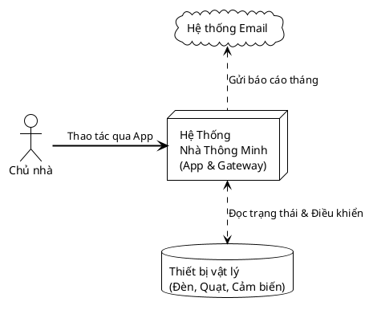
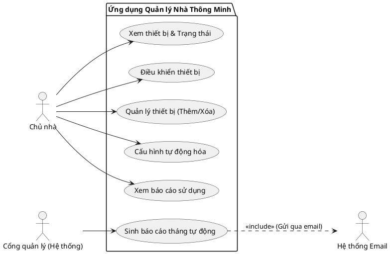
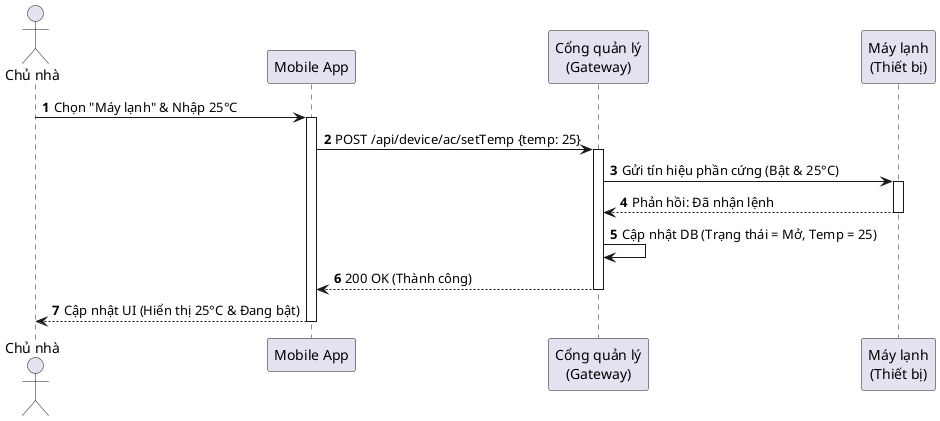
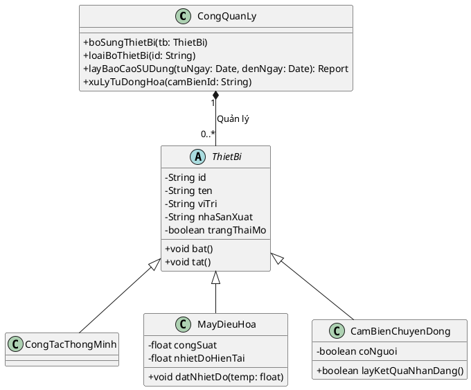
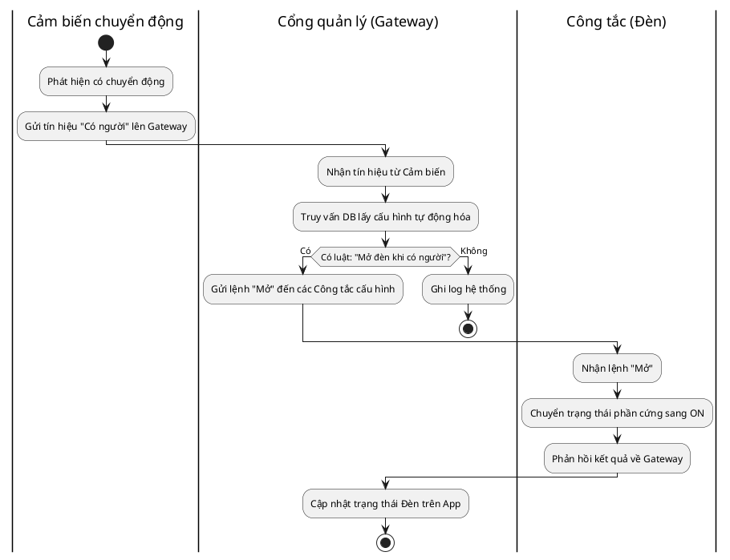
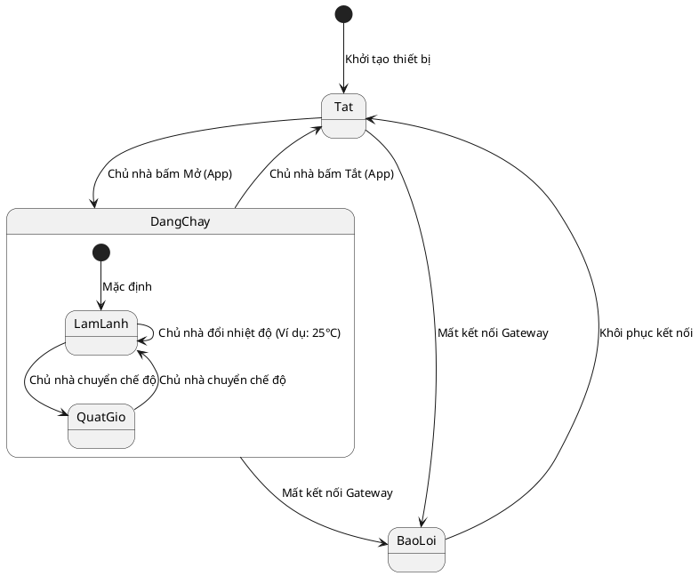

---
\src:
[[07_MoHinhHoaPhanMem.pptx]]

>*Bài này sẽ học về cách để thiết kế, mô tả **hệ thống** mình sẽ xây dựng*
>*Mô hình hóa hệ thống là quá trình "distill" những gì cốt lõi nhất của hệ thống, từ đó ta đưa ra các lựa chọn thiết kế cho phù hợp (là cái khung)*
# Mô hình hóa hệ thống

##### KN
Hệ thống gồm: Thiết bị, phần mềm, con người. Hoạt động trong cùng một môi trường. Hướng về một mục đích:
- Hệ thống hiện tại (system-as-is): Prior state
- Hệ thống phát triển (system-to-be): HT sẽ được phát triển, tiến hóa

***Tại sao cần mô hình hóa? Nó phục vụ cho bước nào?***
- Hiểu tổng thể -> Giao tiếp các bên liên quan
- Giúp thu thập và phân tích yêu cầu *(biết được mô hình hệ thống hiện tại ntn)* để phân tích, thiết kế, cài đặt *(mô hình hệ thống mới)*

***Các lưu ý***
- Mô hình có nhiều dạng biểu diễn, với mức độ chính xác khác nhau
- Mô hình tốt là mô hình gắn với thực tế
- Người ta thường kết hợp nhiều mô hình
- Mô hình ảnh hưởng đến cách vấn đề đc giải quyết *(problem statement)*
# Làm sao để mô hình hóa?
> *Một hệ thống cũng giống như một con người, nhìn từ nhiều góc độ khác nhau:*
> *- Góc nhìn của mẹ: là con*
> *- Góc nhìn của sinh học: là homo sapiens*
> *- ...*
> *Thì hệ thống cũng vậy*

1. GN **bên ngoài**: Ngữ cảnh và môi trường
   *Tại sao lại gọi là "bên ngoài" nghe kì thế?*
2. GN **tương tác**: Môi trường vs Hệ thống OR giữa các thành phần trong nó 
3. GN **cấu trúc**: Tổ chức hệ thống, cấu trúc dữ liệu?
4. GN **hành vi**: Nó sẽ làm gì khi có sk A, B, C? 

>*Vậy có công cụ nào để biểu diễn các góc nhìn này ko?*
>$\to$ Có, **biểu đồ UML**

Mỗi GN sẽ có một loại UML cho nó: 

| Góc nhìn  | Biểu đồ UML tương ứng                                                                                                                                    | Ảnh                                                                                    |
| --------- | -------------------------------------------------------------------------------------------------------------------------------------------------------- | -------------------------------------------------------------------------------------- |
| Bên ngoài | [[Tổng quan về thiết kế hệ thống#Biểu đồ ngữ cảnh\|Biểu đồ ngữ cảnh]]                                                                                    | ![[Pasted image 20260613100248.png\|335]]                                              |
| Tương tác | [[Tổng quan về thiết kế hệ thống#Biểu đồ ca sử dụng\|Biểu đồ ca sử dụng]]  [[Tổng quan về thiết kế hệ thống#Biểu đồ tuần tự\|Biểu đồ tuần tự]]     | ![[Pasted image 20260613100445.png\|333]] ![[Pasted image 20260613100552.png\|347]] |
| Cấu trúc  | [[Tổng quan về thiết kế hệ thống#Biểu đồ lớp\|Biểu đồ lớp]]                                                                                              | ![[Pasted image 20260613100714.png\|365]]                                              |
| Hành vi   | [[Tổng quan về thiết kế hệ thống#Biểu đồ hoạt động\|Biểu đồ hoạt động]]  [[Tổng quan về thiết kế hệ thống#Biểu đồ trạng thái\|Biểu đồ trạng thái]] | ![[Pasted image 20260613100744.png]] ![[Pasted image 20260613100858.png\|361]]      |

Ở phần này sẽ sử dụng ví dụ để hình dung rõ hơn cách tạo, cách làm của mỗi biểu đồ
![[Pasted image 20260613101633.png]]
#### Biểu đồ ngữ cảnh

#### Biểu đồ ca sử dụng

Mỗi usecase biểu diễn MỘT tác vụ rời rạc có liên quan tới sự TƯƠNG TÁC BÊN NGOÀI hệ thống
Các tác nhân có thể là NGƯỜI HOẶC HỆ THỐNG KHÁC
![[Tổng quan về thiết kế hệ thống 2026-06-13 11.25.02.excalidraw]]

Ngoài biểu đồ, có thể biểu diễn dạng bảng

![[Pasted image 20260613113340.png|395]]
#### Biểu đồ tuần tự

Đọc từ Trên $\to$ Dưới (dọc), theo chiều mũi tên (ngang)
- Đường nét đứt đại diện cho **sự tồn tại** của thực thể đó
- Khối chữ nhật dọc đại diện cho **sự thực thi**, nghĩa là tiến trình đang hoạt động. Khi hết khối CN nghĩa là tiến trình kết thúc
#### Biểu đồ lớp
Đã học ở môn OOP

#### Biểu đồ hoạt động

![[Tổng quan về thiết kế hệ thống 2026-06-13 11.09.25.excalidraw|700]]
#### Biểu đồ trạng thái

## Các loại mô hình hóa

#### Mô hình ngữ cảnh
>*Biên hệ thống: Là ranh giới xác định những gì thuộc về hệ thống, gì thuộc môi trường*

Minh họa ngữ cảnh (context) hoạt động của hệ thống, **xác định** nên biên hệ thống
Chỉ QUAN HỆ giữa hệ thống và HỆ THỐNG KHÁC

Được biểu diễn bằng [[Tổng quan về thiết kế hệ thống#Biểu đồ ngữ cảnh|Biểu đồ ngữ cảnh]]

Mô hình quy trình (biểu diễn bằng [[Tổng quan về thiết kế hệ thống#Biểu đồ hoạt động|Biểu đồ hoạt động]]) thường được đặt cạnh để bổ trợ cho mô hình ngữ cảnh
#### Mô hình tương tác
Mô hình hóa tương tác:
- Hệ thống $\leftrightarrow$ Hệ thống
- Người dùng $\leftrightarrow$ Hệ thống

Thường sd [[Tổng quan về thiết kế hệ thống#Biểu đồ ca sử dụng|Biểu đồ ca sử dụng]] và [[Tổng quan về thiết kế hệ thống#Biểu đồ tuần tự|Biểu đồ tuần tự]]
#### Mô hình cấu trúc
Chỉ ra quan hệ giữa các thành phần hệ thống

#### Mô hình hành vi
Mô tả hành vi hệ thống khi nó thực hiện. Cách thức hệ thống phản hồi từ môi trường *(có 2 dạng - Data và Event)*

SD bởi  [[Tổng quan về thiết kế hệ thống#Biểu đồ tuần tự|Biểu đồ tuần tự]] hoặc  [[Tổng quan về thiết kế hệ thống#Biểu đồ hoạt động|Biểu đồ hoạt động]] 2.0

# Kỹ nghệ hướng mô hình
Là phương pháp phát triển phần mềm. 
Các mô hình là **chế tác đầu ra cơ bản** của một quy trình phát triển

>*bình thường đầu ra thiết kế là phần mềm ctrinh (code), nhưng giờ đầu ra là cái mô hình rồi mới đến code (code này là do bộ chuyển đổi, not gõ tay)*

Điều này cho phép kỹ sư làm việc được với chuyên gia miền. Không cần giải thích từng đoạn code và logic cho họ

***Ưu***:
- Sinh mã tự động
- Xét được ở mức trừu tượng cao

***Nhược***:
- Sai khác giữa mức mô hình và mức cài đặt *(do bộ chuyển đổi)*
- Chi phí tạo các bộ chuyển đổi mô hình và các bộ sinh mã tự động

